# Gestão bovina — revisão funcional dos vídeos JetBov

**Revisão:** 30/10/2026. **Finalidade:** referência de trabalho para ampliar o módulo bovino do AgroManage, preservando o estilo e as funcionalidades já existentes.

## 1. Escopo, origem e leitura da evidência

Foram revisados os **23 vídeos incorporados na página oficial de demonstrações**, com análise dos quadros da interface e das legendas automáticas em português. A revisão visual utilizou 16 pontos distribuídos ao longo de cada gravação, com ampliação dos formulários selecionados; não equivale a uma auditoria quadro a quadro de cada interação. Os arquivos de imagem deste pacote são capturas reais extraídas das gravações, sem redesenho ou geração de telas. Não houve acesso a uma conta autenticada da JetBov, à sua base de dados ou ao código do produto.

- Fonte da coleção: [JetBov — demonstrações de animais identificados](https://jetbov.com/demonstracoes-identificados/).
- **Data histórica:** os metadados dos 23 vídeos informam publicação em **11/09/2017**. Portanto, este relatório documenta a versão exibida nessas gravações; não afirma que o produto atual tenha a mesma interface, limites ou regras comerciais.
- **Cobertura produtiva:** a coleção é voltada à pecuária de corte, incluindo reprodução/cria, recria e engorda. O vídeo 07 trata de lotes **sem identificação individual**, apesar do nome geral da página. Não há demonstração de produção leiteira nessa coleção.
- **Limites:** legendas automáticas podem omitir ou trocar palavras. Foram priorizados rótulos visíveis e comportamentos corroborados pela sequência apresentada. Formulários não abertos, fórmulas não definidas e integrações apenas mencionadas são indicados como limites; campos não vistos não foram inventados.
- **Convenção:** “observado/visível” descreve os quadros; “narrado” descreve a explicação do vídeo; **“Para o AgroManage — proposta” é análise nossa**, não uma funcionalidade atribuída à JetBov. Nenhuma proposta significa que já foi implementada.
- Campos com asterisco só são tratados como obrigatórios quando isso é legível. Listar um campo não significa afirmar obrigatoriedade. Referências a SISBOV/GTA/BND são históricas e não verificam requisitos legais atuais.

As capturas preservam logotipos, dados de exemplo e a resolução original dos vídeos (1280 × 720). O minuto/segundo de cada legenda permite conferir a origem. O [manifesto de imagens](imagens-jetbov/manifesto.json) inclui identificação do vídeo, segundo exato de extração e SHA-256; o [índice de capturas](imagens-jetbov/README.md) permite navegar sem percorrer todo o relatório. Não foram incluídos vídeos completos, legendas integrais, credenciais ou dados do banco local.

## 2. Índice dos vídeos

| Nº | Demonstração | Duração | Capturas | Fonte |
|---|---|---:|---:|---|
| 01 | Dicas importantes: navegação e preenchimento | 03:07 | 2 | [Vídeo 01](https://www.youtube.com/watch?v=a89KGvZQWgk) |
| 02 | Painel: indicadores e agendas | 01:44 | 2 | [Vídeo 02](https://www.youtube.com/watch?v=Eg9BksBkIA8) |
| 03 | Gestão de fazendas | 01:27 | 2 | [Vídeo 03](https://www.youtube.com/watch?v=dMQ-uzTOXf4) |
| 04 | Gestão de usuários e permissões | 02:45 | 2 | [Vídeo 04](https://www.youtube.com/watch?v=eKOQemXkug4) |
| 05 | Parceiros: clientes, fornecedores e responsáveis | 02:49 | 3 | [Vídeo 05](https://www.youtube.com/watch?v=hvQbdPBYoYI) |
| 06 | Áreas de pastagem: desenho e ocupação | 03:24 | 3 | [Vídeo 06](https://www.youtube.com/watch?v=Bcij0C-BCIU) |
| 07 | Lotes de animais sem identificação individual | 03:06 | 4 | [Vídeo 07](https://www.youtube.com/watch?v=edPwtXPWHuU) |
| 08 | Animais identificados: cadastro e histórico | 05:13 | 4 | [Vídeo 08](https://www.youtube.com/watch?v=_QfJ3xeBWbs) |
| 09 | Inventário: relatório e sinais de atenção | 03:55 | 3 | [Vídeo 09](https://www.youtube.com/watch?v=e4yhVFPfBSY) |
| 10 | Entrada/aquisição de animais | 05:13 | 3 | [Vídeo 10](https://www.youtube.com/watch?v=aaY28j8YPR0) |
| 11 | Pesagem coletiva de animais identificados | 03:49 | 4 | [Vídeo 11](https://www.youtube.com/watch?v=bQwp77Kb9io) |
| 12 | Manejo sanitário | 03:40 | 3 | [Vídeo 12](https://www.youtube.com/watch?v=Lof44-lka1g) |
| 13 | Manejo de castração | 03:25 | 3 | [Vídeo 13](https://www.youtube.com/watch?v=e0JJuIRo2iQ) |
| 14 | Exposição reprodutiva em grupo | 03:45 | 3 | [Vídeo 14](https://www.youtube.com/watch?v=ijnqpwDr2sg) |
| 15 | Troca de lote | 02:46 | 2 | [Vídeo 15](https://www.youtube.com/watch?v=QDKoSFJKrM0) |
| 16 | Custos nutricionais por competência | 02:38 | 2 | [Vídeo 16](https://www.youtube.com/watch?v=lhpdset3NgU) |
| 17 | Custos indiretos | 02:46 | 2 | [Vídeo 17](https://www.youtube.com/watch?v=0rl0r1G12AY) |
| 18 | Aplicativo de campo e aprovação das atividades | 07:32 | 4 | [Vídeo 18](https://www.youtube.com/watch?v=TmrelHluaMo) |
| 19 | Manejo reprodutivo: ciclo da matriz e do bezerro | 08:25 | 5 | [Vídeo 19](https://www.youtube.com/watch?v=mNREwEhFpeA) |
| 20 | Simulador de venda e resultado econômico | 04:42 | 3 | [Vídeo 20](https://www.youtube.com/watch?v=pO9AeLP7buY) |
| 21 | Fluxo de caixa | 01:39 | 2 | [Vídeo 21](https://www.youtube.com/watch?v=99AIW1RnbIg) |
| 22 | Contas a pagar, a receber e extrato | 05:35 | 4 | [Vídeo 22](https://www.youtube.com/watch?v=E4LvL-wZRZU) |
| 23 | Venda de boi vivo, confirmação e estorno | 05:16 | 4 | [Vídeo 23](https://www.youtube.com/watch?v=NChaKpEJ2Ak) |

## 3. Divisão funcional e tipos de produção

### 3.1 Organização dos módulos na interface demonstrada

| Área | Responsabilidade vista na coleção | Vídeos |
|---|---|---|
| Painel | Situação atual, desempenho e agenda | 01–02 |
| Cadastros e acesso | Fazendas, usuários e parceiros | 03–05 |
| Estrutura do rebanho | Pastagens, lotes coletivos, animais e inventário | 06–09 |
| Entradas | Aquisição, origem, identificação e confirmação | 10 |
| Manejo | Pesagem, sanidade, castração, exposição, troca de lote | 11–15 |
| Custos | Nutrição por competência e despesas indiretas | 16–17 |
| Atividades de campo | Coleta offline, sincronização e conferência web | 18 |
| Reprodução | Exposição, diagnóstico, parto, bezerro e desmame | 14 e 19 |
| Inteligência | Simulação de venda e comparação atual/futura | 20 |
| Financeiro | Fluxo de caixa, títulos, baixas e extrato | 21–22 |
| Saídas | Venda de boi vivo, documentação e estorno | 23 |

A navegação lateral vista inclui grupos como Financeiro, Animais, Lotes, Atividades, Entradas, Manejo, Custos, Inteligência, Saídas, Parceiros, Relatórios e Meus Dados. A presença de um item no menu não comprova todos os seus subfluxos. Por exemplo, não há entre os 23 vídeos uma demonstração completa dedicada ao acerto de abate em frigorífico.

### 3.2 Eixos que devem permanecer separados no AgroManage

| Eixo | Exemplos e significado | Evidência / limite |
|---|---|---|
| Identificação | Animal por brinco versus saldo de um lote coletivo | Ambos demonstrados; não duplicar cabeças |
| Fase produtiva de corte | Cria, recria, engorda/terminação | Os fluxos apoiam essas etapas; não se comprovou um cadastro formal com exatamente esses três nomes |
| Categoria/sexo | Bezerro, matriz, macho, fêmea, castrado etc. | Características do animal; não são modalidade financeira |
| Situação reprodutiva | Exposta, prenhe/vazia, lactante; eventos de perda e desmame | Exposição não é diagnóstico; lactante não prova controle leiteiro |
| Local físico | Fazenda e pasto/piquete | Diferente do lote de manejo; vários lotes podem compartilhar área |
| Agrupamento | Lote nutricional/produtivo, com metas | Não deve apagar o histórico de localização |
| Sistema de criação | Pasto, suplementação, confinamento/semiconfinamento | O material mostra pastagem e custo nutricional; não comprova módulos especializados completos para cada sistema |
| Comercialização | Peso vivo, referência de carcaça, preço por kg/cabeça | Diferente de fase de criação e de efetivo recebimento |
| Produção leiteira | Ordenha, lactação, descarte, tanque, qualidade e venda de leite | Extensão proposta neste relatório; não demonstrada nos 23 vídeos |

Para uma operação de ciclo completo, a mesma fazenda pode executar cria, recria e engorda. Uma matriz também pode ser lactante e estar gestante: principalmente no leite, não convém representar toda a realidade por um único estado mutuamente exclusivo.

## 4. Análise de cada vídeo e capturas de referência

Os horários abaixo são relativos ao início de cada vídeo. As capturas mostram um instante do formulário: campos abaixo da rolagem podem estar em outra imagem do mesmo vídeo. Os nomes curtos das capturas são descrições editoriais; os rótulos do sistema são os da imagem.

### V01 — Dicas importantes: navegação e preenchimento

[Assistir à demonstração](https://www.youtube.com/watch?v=a89KGvZQWgk) · 03:07 · publicada em 11/09/2017.

**Objetivo.** Apresentar as convenções gerais da aplicação e a navegação para animais identificados. Parte do vídeo é composta de slides explicativos; as capturas correspondentes são slides reais da gravação, não formulários interativos.

**Interface e regras observadas/narradas.** Menu principal lateral; seleção da fazenda no topo; área de trabalho central; atalhos de ajuda, bloqueio e saída. O acesso é feito pela internet, com usuário e senha, e existe recuperação de senha. Campos com asterisco são apresentados como obrigatórios; a validação ocorre ao salvar. As tabelas permitem ordenação pelos títulos das colunas. O brinco aceita identificação alfanumérica; a narração alerta para diferenciação entre maiúsculas e minúsculas na versão histórica.

**Para o AgroManage — proposta.** Manter o padrão visual já aprovado no sistema, com hierarquia clara de página, filtros, tabela e ações. Definir uma política única para normalização e unicidade do brinco por fazenda; não reproduzir diferenças de caixa por acidente. Exibir validações junto ao campo, unidades explícitas e mensagens em português. A troca de fazenda deve respeitar a organização e as permissões existentes.

**Capturas reais**

**Navegacao — [01:27](https://www.youtube.com/watch?v=a89KGvZQWgk&t=87s)**

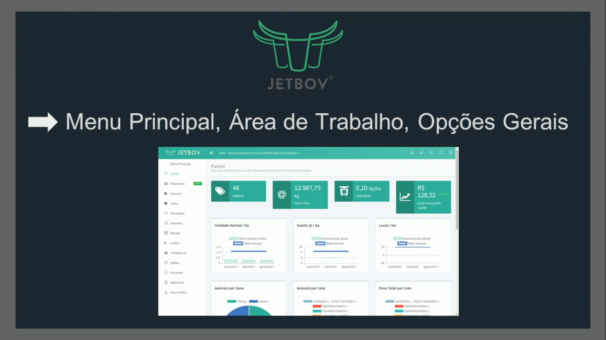

**Campos obrigatorios — [02:13](https://www.youtube.com/watch?v=a89KGvZQWgk&t=133s)**

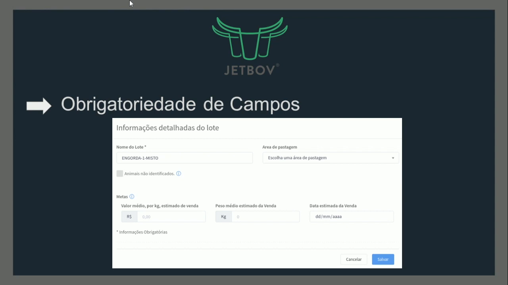

### V02 — Painel: indicadores e agendas

[Assistir à demonstração](https://www.youtube.com/watch?v=Eg9BksBkIA8) · 01:44 · publicada em 11/09/2017.

**Objetivo.** Oferecer uma visão rápida do rebanho, da ocupação e dos próximos trabalhos.

**Componentes.** Contagem de animais ativos, peso total, ganho médio diário (GMD) e referência de mercado ESALQ/BMF aparecem na apresentação. Gráficos de desempenho incluem lotação em UA/ha, ganho de arrobas por hectare e lucro por hectare. Há divisões do rebanho por sexo e lote e gráficos de distribuição de peso. O painel também reúne próximas atividades sanitárias e previsão de partos.

**Atualização.** A narração distingue indicadores calculados até o dia anterior de contagens/distribuições atuais. Isso afeta a interpretação dos números: diferentes cartões podem ter momentos de referência diferentes.

**Para o AgroManage — proposta.** Cartões clicáveis que abram a lista filtrada que produziu o indicador; seleção de fazenda/período; indicação de data de atualização. Separar quantidade de cabeças, massa viva, desempenho, reprodução e finanças. Mostrar ausência de pesagem/área/dados de custo, em vez de apresentar zero como se fosse resultado confirmado.

**Capturas reais**

**Indicadores — [00:31](https://www.youtube.com/watch?v=Eg9BksBkIA8&t=31s)**

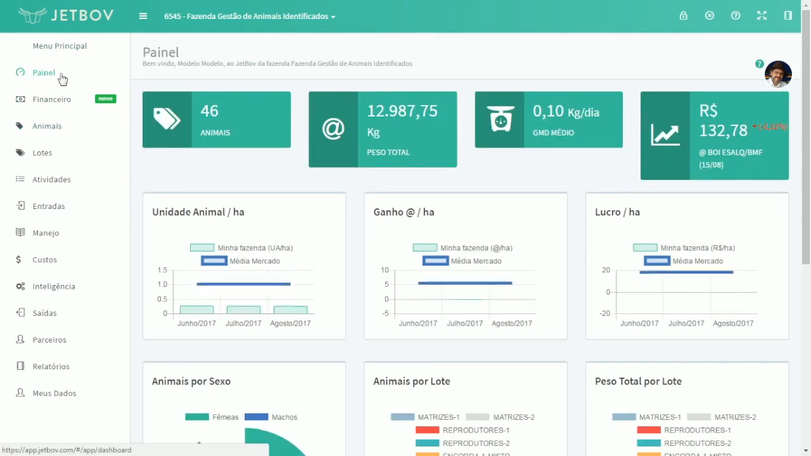

**Agendas — [01:18](https://www.youtube.com/watch?v=Eg9BksBkIA8&t=78s)**

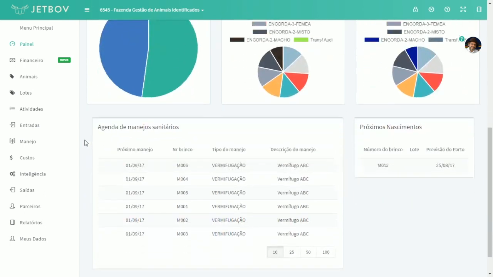

### V03 — Gestão de fazendas

[Assistir à demonstração](https://www.youtube.com/watch?v=dMQ-uzTOXf4) · 01:27 · publicada em 11/09/2017.

**Objetivo e fluxo.** Listar e editar fazendas e alternar a unidade de trabalho. A primeira fazenda é criada no início do uso; a disponibilidade de múltiplas fazendas depende da configuração comercial narrada na versão antiga.

**Campos visíveis no cadastro.** Nome da fazenda; endereço; bairro; CEP; cidade; estado; país; latitude; longitude; área total de pastagem; CNPJ/CPF; inscrição estadual; ID SISBOV; NRF; INCRA; SisATAK. Alguns campos documentais são marcados com dois asteriscos, relacionados a informações exigidas para SISBOV na demonstração; isso não equivale a dizer que todos sejam obrigatórios para qualquer cadastro.

**Uso funcional.** A área de pastagem alimenta indicadores por hectare. Endereço, coordenadas e dados cadastrais cumprem papéis distintos; a área total não substitui os polígonos das subdivisões de pasto.

**Para o AgroManage — proposta.** Reutilizar o cadastro de fazendas existente. Acrescentar apenas dados necessários, com permissões por organização e fazenda. Manter escolha/consulta de planos nas configurações da organização, conforme a decisão já tomada para o produto. Os campos SISBOV observados são referência histórica, não comprovação de requisitos legais atuais.

**Capturas reais**

**Listagem — [00:22](https://www.youtube.com/watch?v=dMQ-uzTOXf4&t=22s)**

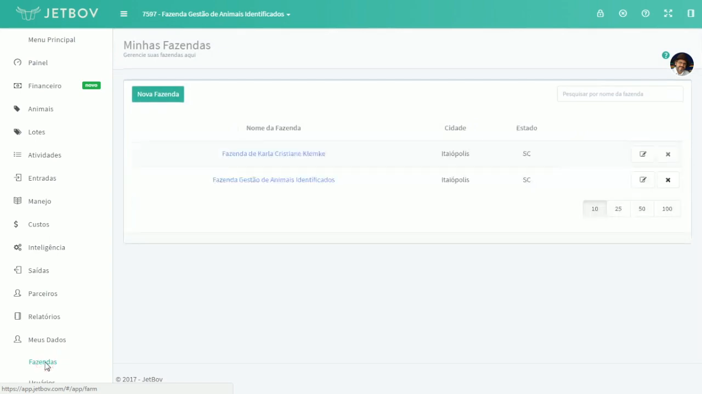

**Cadastro fazenda — [00:41](https://www.youtube.com/watch?v=dMQ-uzTOXf4&t=41s)**

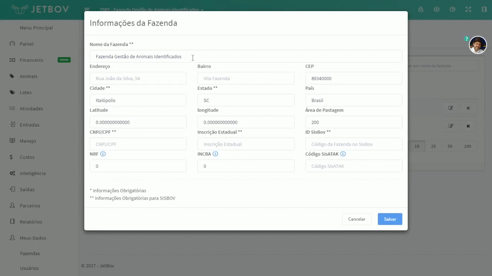

### V04 — Gestão de usuários e permissões

[Assistir à demonstração](https://www.youtube.com/watch?v=eKOQemXkug4) · 02:45 · publicada em 11/09/2017.

**Fluxo.** Convidar uma pessoa por e-mail, escolher as fazendas autorizadas e definir permissões. A lista permite consultar usuários vinculados. A narração descreve alteração de perfil por remoção e novo convite, mantendo os registros anteriores; trata-se do funcionamento histórico apresentado.

**Controles visíveis/narrados.** E-mail do convidado; seleção de fazendas; somente leitura; recebimento de e-mails semanais; emissão de relatórios; abertura de custos. Assim, poder acessar o rebanho não implica poder consultar valores financeiros.

**Distinção importante.** Usuário convidado é uma identidade com acesso ao sistema. Parceiro comercial/veterinário é um cadastro operacional e não ganha acesso simplesmente por ter seu e-mail informado.

**Para o AgroManage — proposta.** Preservar a autorização existente e criar capacidades específicas quando necessárias: consultar, manejar, confirmar, estornar, exportar e ver custos. Permitir administração de permissões sem apagar autoria ou histórico. Uma ação coletiva precisa validar todos os animais e fazendas no servidor; esconder o botão na interface não substitui autorização.

**Capturas reais**

**Convite permissoes — [00:47](https://www.youtube.com/watch?v=eKOQemXkug4&t=47s)**

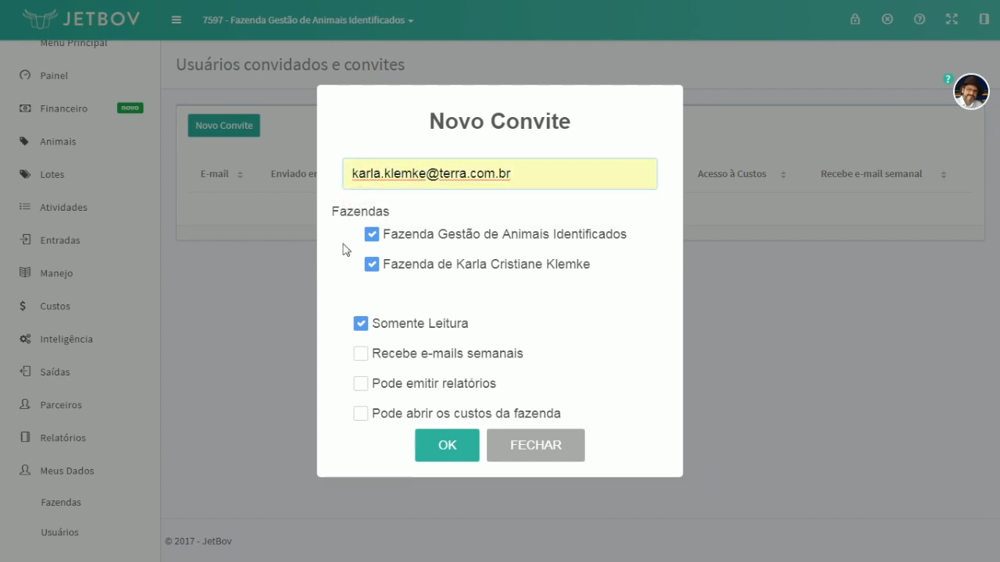

**Usuarios — [01:37](https://www.youtube.com/watch?v=eKOQemXkug4&t=97s)**

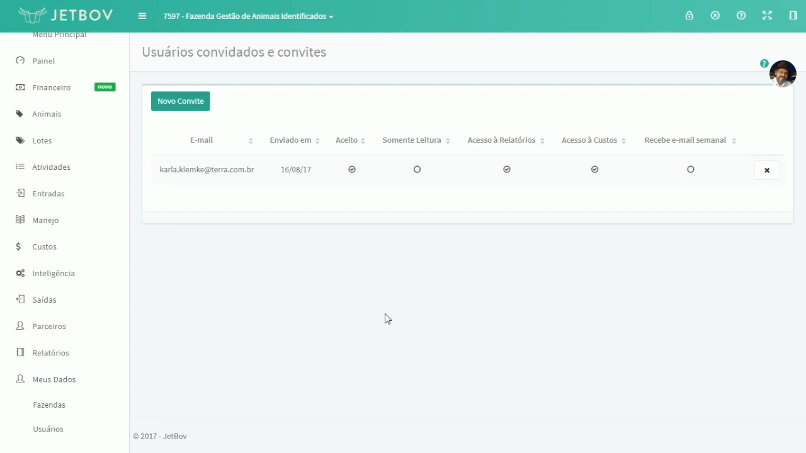

### V05 — Parceiros: clientes, fornecedores e responsáveis

[Assistir à demonstração](https://www.youtube.com/watch?v=hvQbdPBYoYI) · 02:49 · publicada em 11/09/2017.

**Objetivo.** Centralizar pessoas e empresas reutilizadas em compras, vendas, custos e procedimentos reprodutivos. A listagem oferece consulta por nome e tipo de parceiro.

**Campos observados.** Nome e tipo; e-mail; CPF/CNPJ; inscrição estadual; código SISATAK; telefones comercial, residencial e celular; propriedade; endereço; cidade; estado; CEP; NRF; INCRA; observações. Há uma opção para adicionar o parceiro em todas as fazendas. O seletor de tipos diferencia papéis como fornecedor, veterinário e frigorífico; consultar a captura para a nomenclatura histórica completa, sem pressupor que todos os itens sejam necessários no AgroManage.

**Relacionamentos e uso.** Produtor de origem na aquisição; comprador na venda; veterinário/responsável na reprodução; contraparte em lançamentos financeiros. A narração menciona envio de documentos ao e-mail do parceiro, o que é distinto de conceder acesso à aplicação.

**Para o AgroManage — proposta.** Reutilizar pessoas/fornecedores/clientes já existentes, evitando duplicação de cadastros. Se houver compartilhamento entre fazendas, limitá-lo à mesma organização e às permissões aplicáveis. Contatos de demonstração nas capturas são conteúdo do vídeo público; não são dados da base local.

**Capturas reais**

**Cadastro parceiro — [00:48](https://www.youtube.com/watch?v=hvQbdPBYoYI&t=48s)**

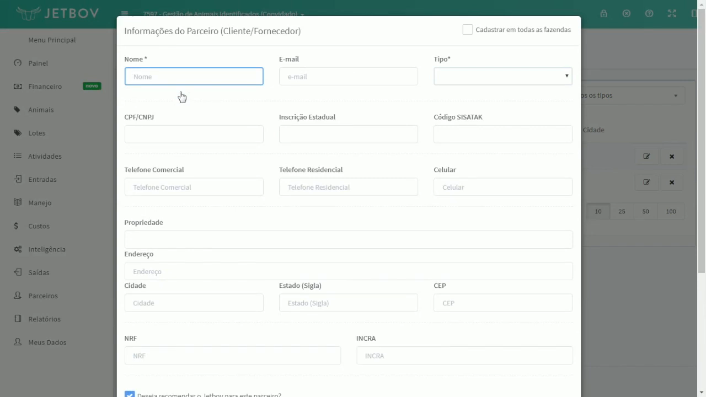

**Tipos parceiro — [01:09](https://www.youtube.com/watch?v=hvQbdPBYoYI&t=69s)**

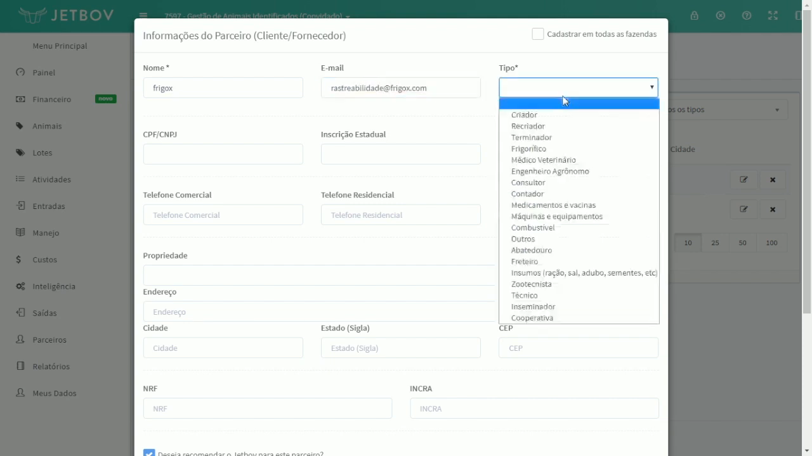

**Observacoes parceiro — [01:50](https://www.youtube.com/watch?v=hvQbdPBYoYI&t=110s)**

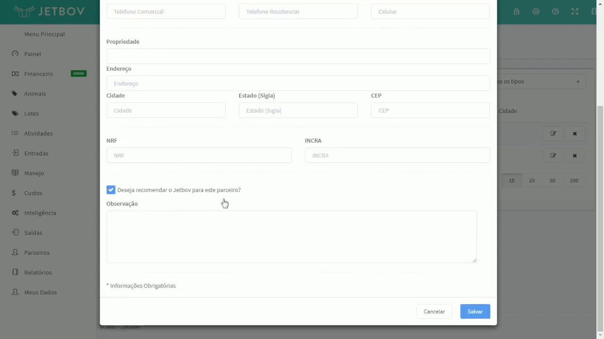

### V06 — Áreas de pastagem: desenho e ocupação

[Assistir à demonstração](https://www.youtube.com/watch?v=Bcij0C-BCIU) · 03:24 · publicada em 11/09/2017.

**Fluxo.** Buscar a localização da fazenda no mapa, aproximar a imagem, desenhar um polígono fechado e salvar a área. O tamanho é calculado a partir do desenho. A apresentação relaciona as áreas cadastradas aos lotes que as ocupam.

**Campos visíveis.** Nome da área, tamanho em hectares, lotação máxima em UA/ha, observações e palavras-chave. Nome, tamanho e lotação máxima aparecem com marcação de obrigatoriedade. A tabela permite comparar ocupação e capacidade.

**Regra narrada.** Na convenção dessa demonstração, 1 UA corresponde a 450 kg. A lotação considera peso vivo por hectare e a ocupação percentual compara a lotação atual com a máxima. Mais de um lote pode estar associado à mesma área.

**Para o AgroManage — proposta.** Separar a entidade física pasto/piquete do agrupamento de animais. Guardar geometria, área e capacidade em campos próprios; registrar entrada/saída para reconstruir ocupação histórica. Definir o tratamento de animais sem peso e de dados antigos antes de mostrar capacidade. Mapa/satélite é uma capacidade adicional: o cadastro manual de hectares não a implementa por si só.

**Capturas reais**

**Desenho area — [01:10](https://www.youtube.com/watch?v=Bcij0C-BCIU&t=70s)**

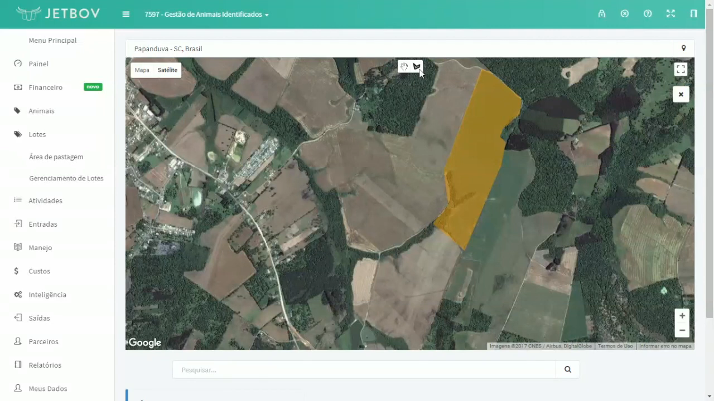

**Cadastro area — [01:48](https://www.youtube.com/watch?v=Bcij0C-BCIU&t=108s)**

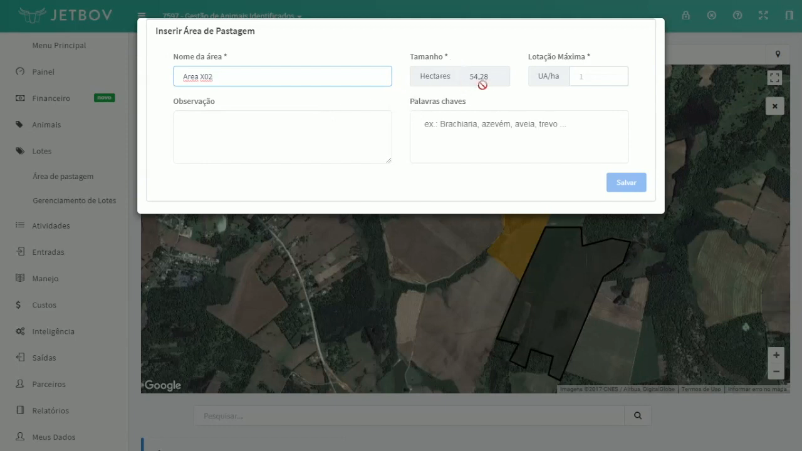

**Ocupacao pastagens — [02:50](https://www.youtube.com/watch?v=Bcij0C-BCIU&t=170s)**

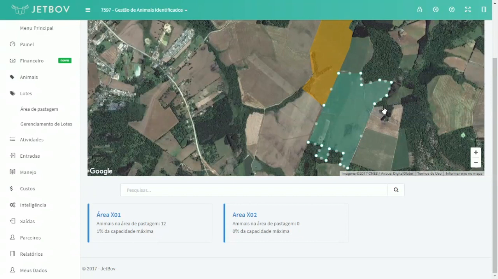

### V07 — Lotes de animais sem identificação individual

[Assistir à demonstração](https://www.youtube.com/watch?v=edPwtXPWHuU) · 03:06 · publicada em 11/09/2017.

**Escopo.** Este vídeo trata explicitamente de animais SEM identificação. A unidade de controle é um grupo com quantidade e peso médio; não é uma ficha por brinco.

**Cadastro e indicadores.** Nome do lote, área de pastagem, indicação de animais não identificados e metas de venda: preço estimado por kg, peso médio pretendido e data estimada. A listagem apresenta cabeças, peso total, peso médio e GMD.

**Movimentações.** Entrada de machos/fêmeas, peso médio e data de entrada; pesagem coletiva; transferência de quantidade entre lotes; venda do conjunto. A apresentação diferencia venda por peso vivo e por carcaça. Também mostra edição e exclusão em operações históricas.

**Para o AgroManage — proposta.** Suportar lotes coletivos com saldos quantitativos e reconciliação de peso. Não inventar brincos para simular animais inexistentes. Ao individualizar parte do grupo, reduzir seu saldo coletivo na mesma transação para evitar contagem dupla. Definir origem, destino e quantidade de toda movimentação. A exclusão de um lote movimentado deve ser substituída por encerramento/estorno auditável, conforme a situação.

**Capturas reais**

**Indicadores lotes — [00:30](https://www.youtube.com/watch?v=edPwtXPWHuU&t=30s)**

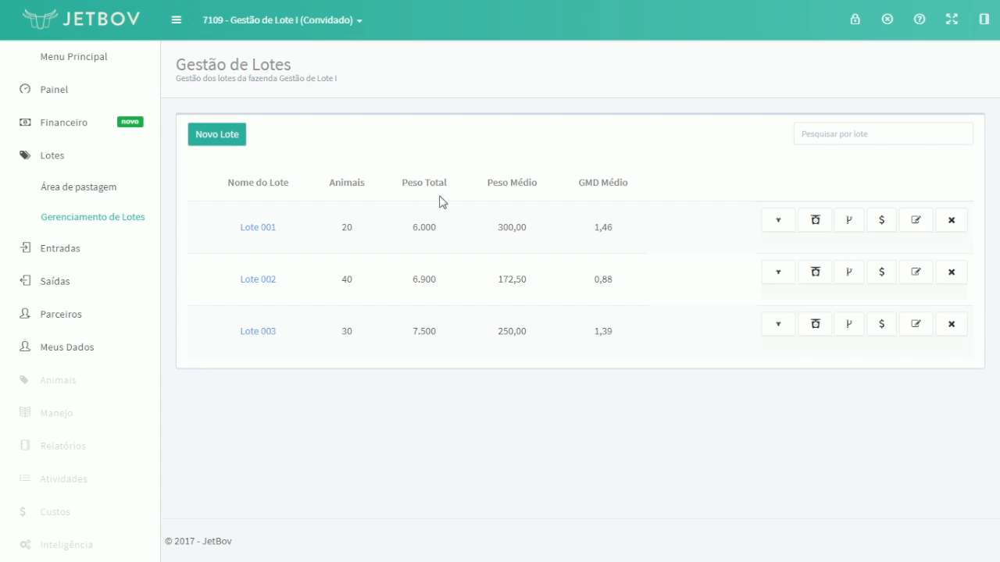

**Cadastro lote — [00:42](https://www.youtube.com/watch?v=edPwtXPWHuU&t=42s)**

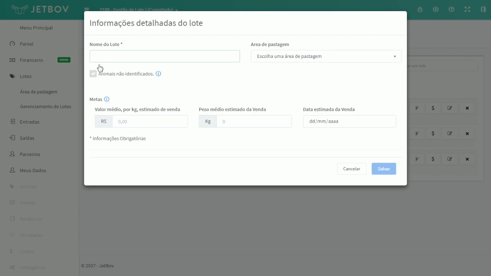

**Entrada coletiva — [01:50](https://www.youtube.com/watch?v=edPwtXPWHuU&t=110s)**

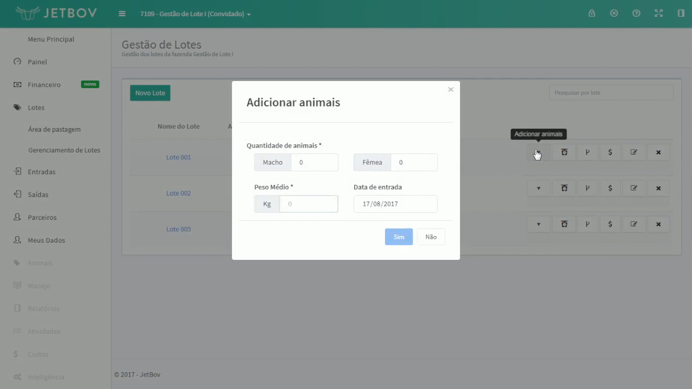

**Tipos venda — [02:12](https://www.youtube.com/watch?v=edPwtXPWHuU&t=132s)**

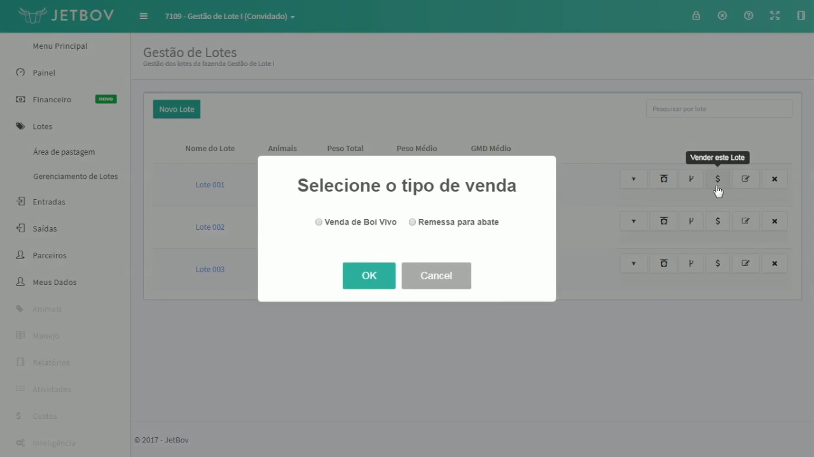

### V08 — Animais identificados: cadastro e histórico

[Assistir à demonstração](https://www.youtube.com/watch?v=_QfJ3xeBWbs) · 05:13 · publicada em 11/09/2017.

**Listagem.** Brinco, lote, sexo, idade, tempo na fazenda, último peso, ganho de peso, GMD e indicação de carência. Há pesquisa, filtros por lote/faixa etária/animais sem brinco, paginação, novo cadastro, importação e exportação. A narração menciona importação de histórico de pesagens e documentos SISBOV.

**Campos visíveis na aba “Dados do Animal”.** Brinco; lote; sexo; número SISBOV; data de registro na BND; data e peso de entrada; castrado; raça; pelagem; marca; produtor de origem; preço de compra por kg; frete de compra; nascimento; desmame; categoria. O sexo tem asterisco na captura; não se deve declarar que todo campo listado é obrigatório. As abas “Registro e Genealogia” e “Observações” aparecem, mas seus formulários internos não são demonstrados nessa captura: não há base para inventariar todos os campos de genealogia.

**Operações.** Pesagem e procedimento sanitário individuais, edição, detalhes e históricos separados de pesagens, sanidade e reprodução. A remoção é apresentada para corrigir cadastro indevido, não como substituto de venda ou mortalidade.

**Para o AgroManage — proposta.** Uma ficha central com linha do tempo e relações de origem/parentesco, mantendo os lançamentos em seus domínios. Preservar unicidade de identificadores, dados de entrada e histórico. Venda, morte e correção de cadastro são eventos diferentes.

**Capturas reais**

**Listagem animais — [00:27](https://www.youtube.com/watch?v=_QfJ3xeBWbs&t=27s)**

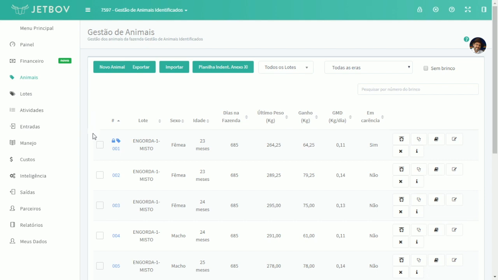

**Cadastro animal — [01:07](https://www.youtube.com/watch?v=_QfJ3xeBWbs&t=67s)**

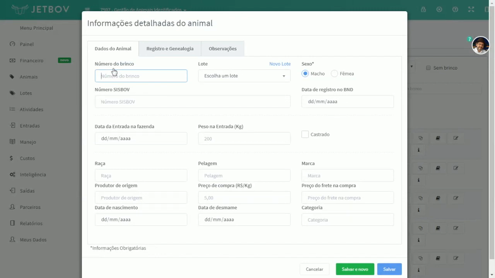

**Sanitario individual — [02:46](https://www.youtube.com/watch?v=_QfJ3xeBWbs&t=166s)**

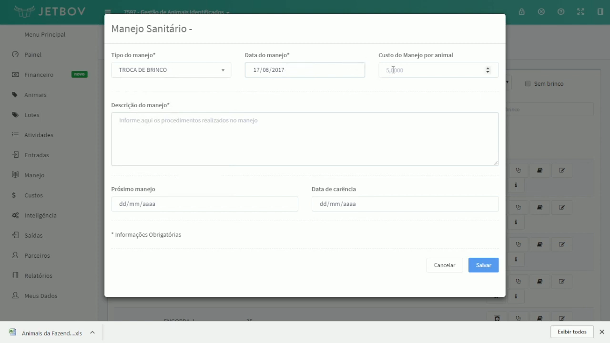

**Historico animal — [03:06](https://www.youtube.com/watch?v=_QfJ3xeBWbs&t=186s)**

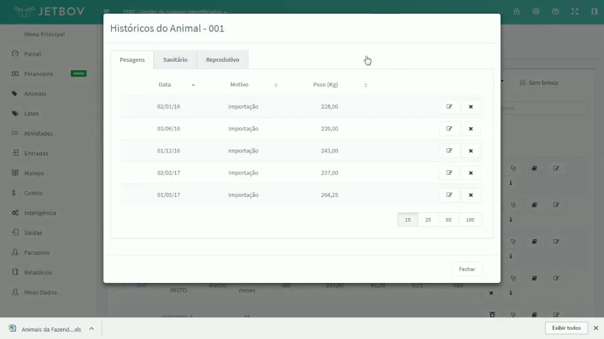

### V09 — Inventário: relatório e sinais de atenção

[Assistir à demonstração](https://www.youtube.com/watch?v=e4yhVFPfBSY) · 03:55 · publicada em 11/09/2017.

**Fluxo.** Escolher lote, sexo, agrupamento e faixa etária, abrir o relatório e analisar gráfico, legenda e tabela. A apresentação usa agrupamentos por idade/categoria/peso. Após alterar filtros, o usuário precisa abrir novamente o relatório na versão demonstrada.

**Saída.** Contagem por grupo, totais e relação detalhada por animal, com lote, brinco, sexo, idade, peso e GMD. Ícones sinalizam tendência de peso, carência e período sem eventos, incluindo a referência de mais de 30 dias mencionada na narração. Existem exportação para planilha e saída em PDF/impressão.

**Interpretação.** É uma visão gerencial do rebanho, não uma entrada física de estoque. O relatório facilita selecionar grupos para manejo, mas não demonstra execução automática desses manejos. Exemplos sanitários da explicação não devem ser convertidos em protocolo veterinário atual.

**Para o AgroManage — proposta.** Filtros reproduzíveis, totalizadores consistentes com a tabela e exportação com os filtros utilizados. Diferenciar ganho real de peso, ausência de pesagem e perda de peso; cada alerta deve explicar seu motivo e a data usada. Cabeças individuais e saldos coletivos exigem agregação sem duplicidade.

**Capturas reais**

**Agrupamentos — [01:35](https://www.youtube.com/watch?v=e4yhVFPfBSY&t=95s)**

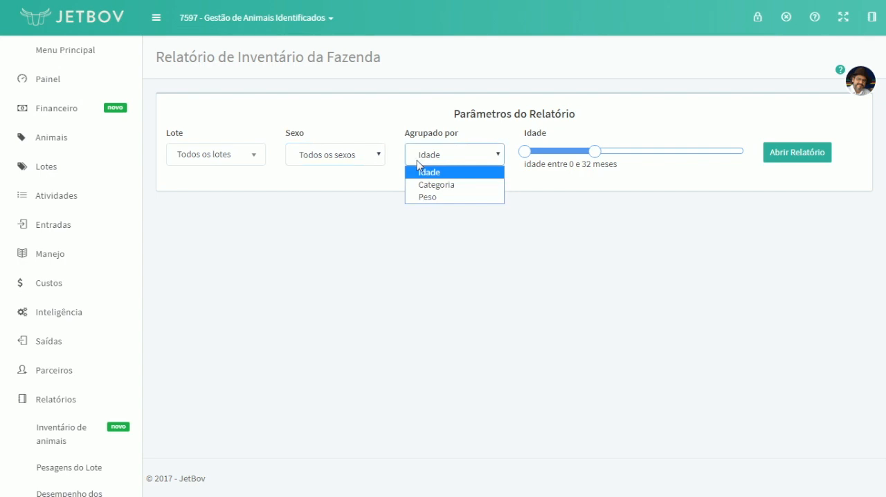

**Grafico inventario — [02:04](https://www.youtube.com/watch?v=e4yhVFPfBSY&t=124s)**

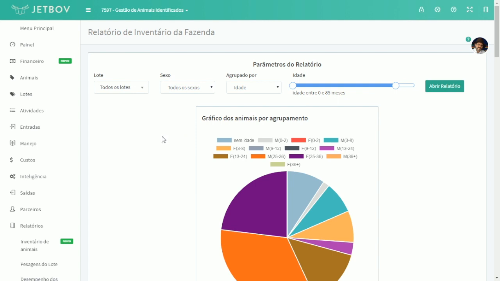

**Sinais inventario — [03:17](https://www.youtube.com/watch?v=e4yhVFPfBSY&t=197s)**

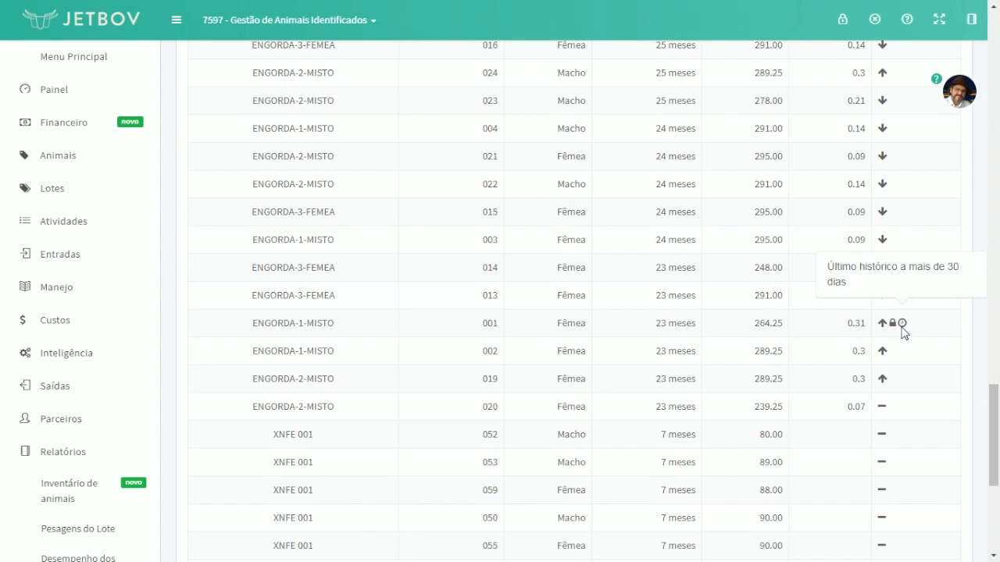

### V10 — Entrada/aquisição de animais

[Assistir à demonstração](https://www.youtube.com/watch?v=aaY28j8YPR0) · 05:13 · publicada em 11/09/2017.

**Separação funcional.** Comprar animais é uma operação com cabeçalho, participantes e confirmação; não se resume a preencher o formulário de um animal. A lista diferencia aquisições pendentes e confirmadas e permite filtrar por lote/referência.

**Cabeçalho.** Referência da compra/documento, produtor de origem, data, forma de precificação por kg ou cabeça, preço e frete total. O frete é distribuído entre os animais conforme a explicação; a regra exata de distribuição deve ser definida antes de implementar.

**Participantes.** Na modalidade identificada aparecem quantidades de machos/fêmeas, lote, nascimento, raça e categoria, seguidas da inclusão dos brincos. Na coletiva aparecem quantidades por sexo, lote e peso médio. Há opção relacionada à GTA e observações; não pressupor validação eletrônica da GTA só pela presença do campo.

**Fluxo.** Criar aquisição → incluir/identificar animais → eventualmente associar procedimento sanitário → conferir → confirmar. A confirmação oficializa a operação. Antes dela existem edição/exclusão; depois surgem possibilidades de documentação SISBOV/BND na versão apresentada.

**Para o AgroManage — proposta.** Transação única para documento, animais/saldo coletivo, custo de aquisição, frete e integração financeira aplicável. Guardar rastreabilidade e impedir confirmação duplicada. Cadastro inicial/inventário e compra financeira precisam ser origens distintas.

**Capturas reais**

**Compra identificados — [01:27](https://www.youtube.com/watch?v=aaY28j8YPR0&t=87s)**

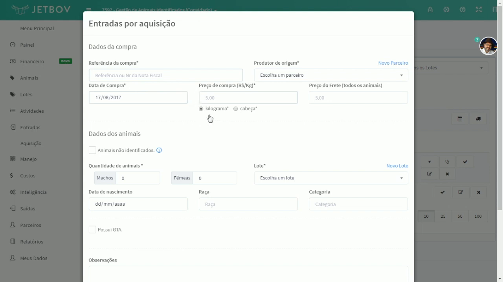

**Compra coletiva — [01:47](https://www.youtube.com/watch?v=aaY28j8YPR0&t=107s)**

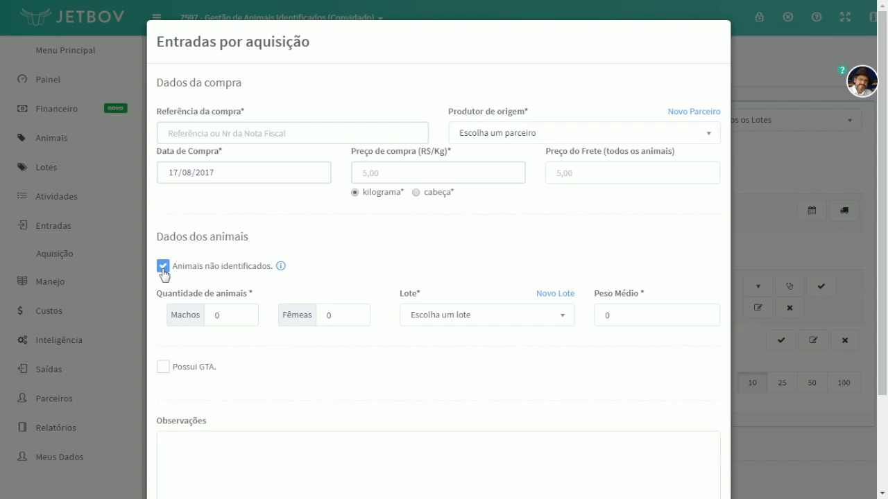

**Identificacao compra — [02:46](https://www.youtube.com/watch?v=aaY28j8YPR0&t=166s)**

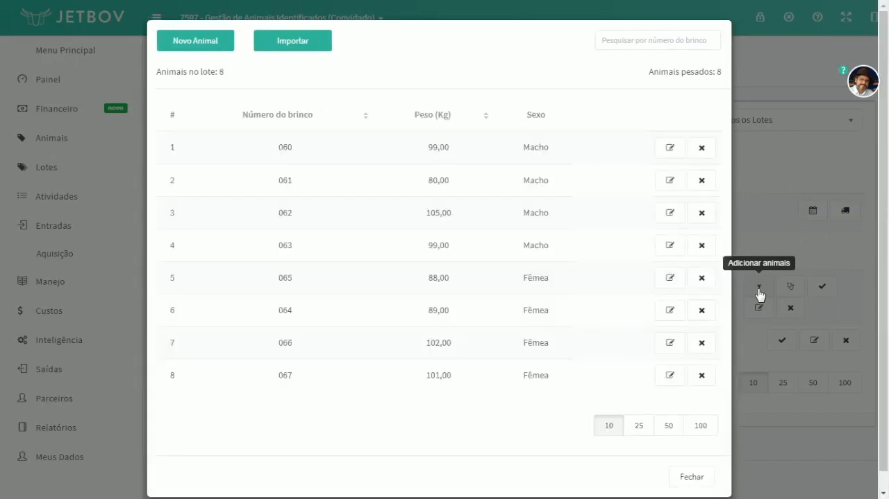

### V11 — Pesagem coletiva de animais identificados

[Assistir à demonstração](https://www.youtube.com/watch?v=bQwp77Kb9io) · 03:49 · publicada em 11/09/2017.

**Cabeçalho.** Data do manejo, lote, motivo e observações. É possível registrar data anterior; a demonstração distingue a data do fato do momento de digitação.

**Participantes e dados.** Selecionar apenas os animais efetivamente pesados e informar o peso de cada um. O lote do cabeçalho não significa que todos os seus animais foram pesados. Animais de outro lote são sinalizados; a confirmação pode solicitar a transferência para o lote de destino. Há associação de procedimentos sanitários ao conjunto manejado.

**Estados e efeitos.** A pesagem permanece pendente até confirmar. Antes da confirmação pode ser editada ou removida; depois entra no histórico e nos relatórios de desempenho. A apresentação também mostra a conversão de uma pesagem em operação de venda, com escolha de peso vivo ou carcaça.

**Para o AgroManage — proposta.** Grade de lançamento rápido com pesquisa por brinco, leitura de dispositivo quando houver integração e validações por linha. Uma pesagem retroativa deve entrar na posição cronológica correta e recalcular os indicadores afetados, sem substituir o último peso por uma medição mais antiga. Evitar misturar o simples registro de peso com uma venda já concluída.

**Capturas reais**

**Cadastro pesagem — [00:50](https://www.youtube.com/watch?v=bQwp77Kb9io&t=50s)**

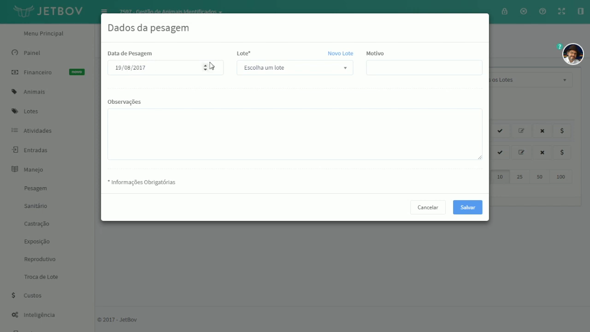

**Pesos individuais — [01:33](https://www.youtube.com/watch?v=bQwp77Kb9io&t=93s)**

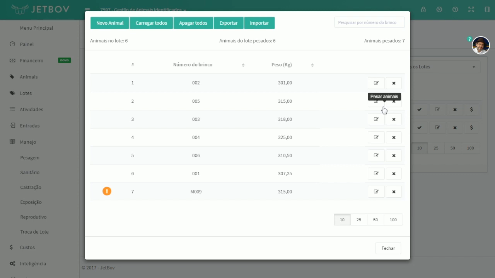

**Confirmacao pesagem — [02:15](https://www.youtube.com/watch?v=bQwp77Kb9io&t=135s)**

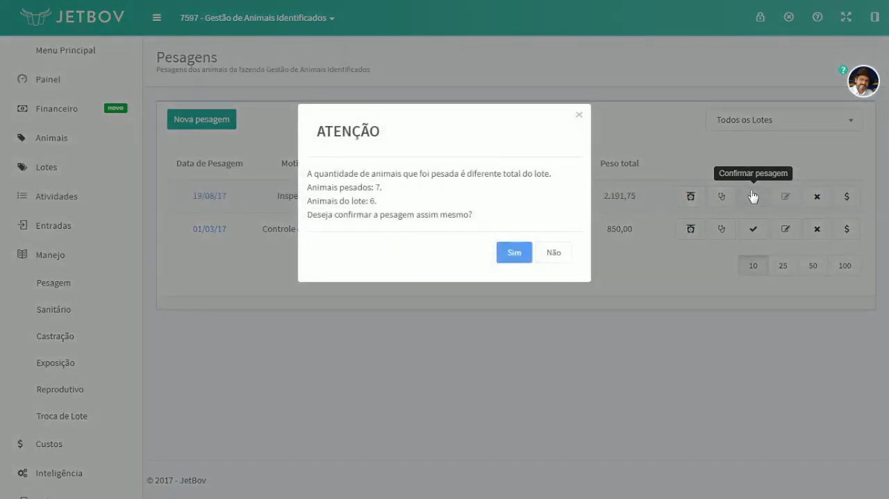

**Pesagem venda — [02:58](https://www.youtube.com/watch?v=bQwp77Kb9io&t=178s)**

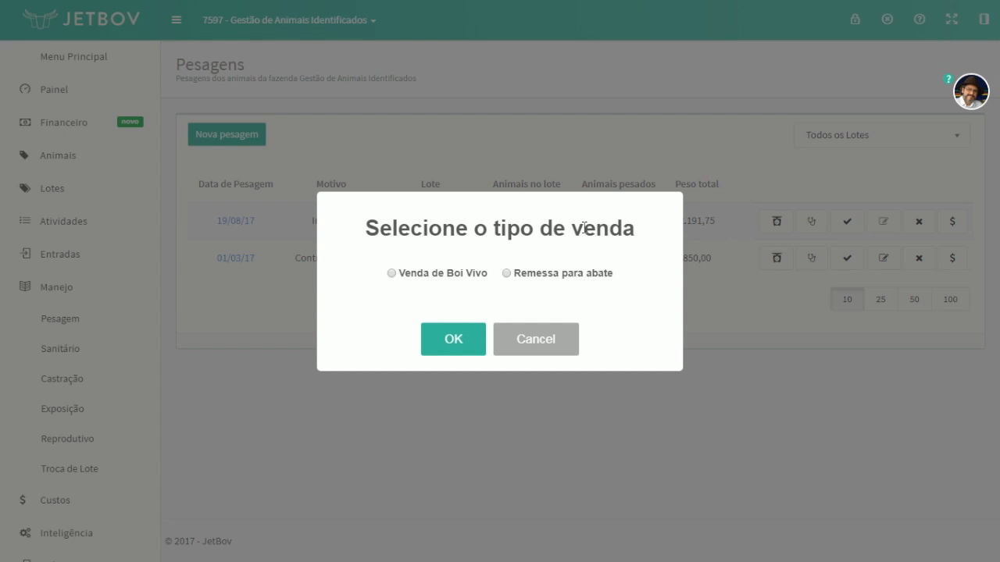

### V12 — Manejo sanitário

[Assistir à demonstração](https://www.youtube.com/watch?v=Lof44-lka1g) · 03:40 · publicada em 11/09/2017.

**Cabeçalho e participantes.** Data e lote; seleção dos animais tratados. A lista efetiva de participantes é parte do registro. Como em outros manejos, animais de lotes diferentes podem demandar confirmação de transferência.

**Campos do procedimento.** Tipo, data, custo por animal, descrição, data do próximo procedimento e data final de carência. O mesmo manejo pode associar procedimentos ao conjunto selecionado. A programação alimenta lembretes e as aplicações entram no histórico sanitário/mapa sanitário após confirmação.

**Fluxo.** Criar manejo → cadastrar procedimento(s) → escolher animais → revisar → confirmar. Há edição/exclusão de pendências. A ficha do animal também oferece lançamento sanitário individual.

**Para o AgroManage — proposta.** Vincular produto/lote, aplicação, dose/unidade, responsável, custo e carências pertinentes. Produto e retirada de estoque são integração a especificar; este vídeo não comprova baixa automática de estoque. Para corte/leite, carência de abate e de leite precisam de tratamento próprio, com motivo e data de liberação. Não transformar o exemplo de procedimento do vídeo em prescrição. Registrar correções e estornos sem apagar rastreabilidade.

**Capturas reais**

**Cabecalho sanitario — [01:02](https://www.youtube.com/watch?v=Lof44-lka1g&t=62s)**

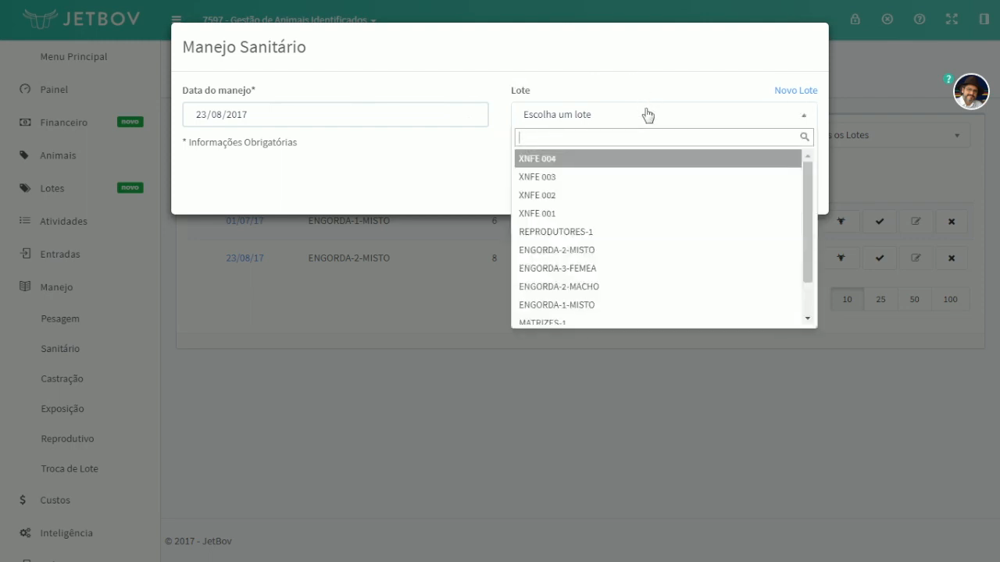

**Procedimento sanitario — [01:43](https://www.youtube.com/watch?v=Lof44-lka1g&t=103s)**

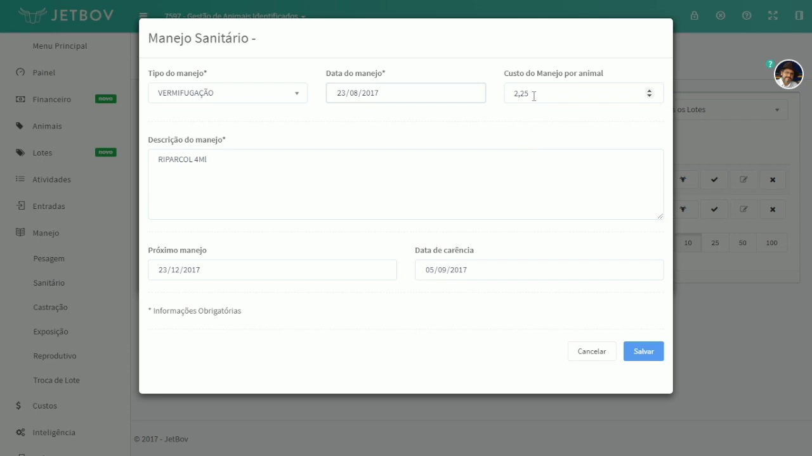

**Animais tratados — [02:10](https://www.youtube.com/watch?v=Lof44-lka1g&t=130s)**

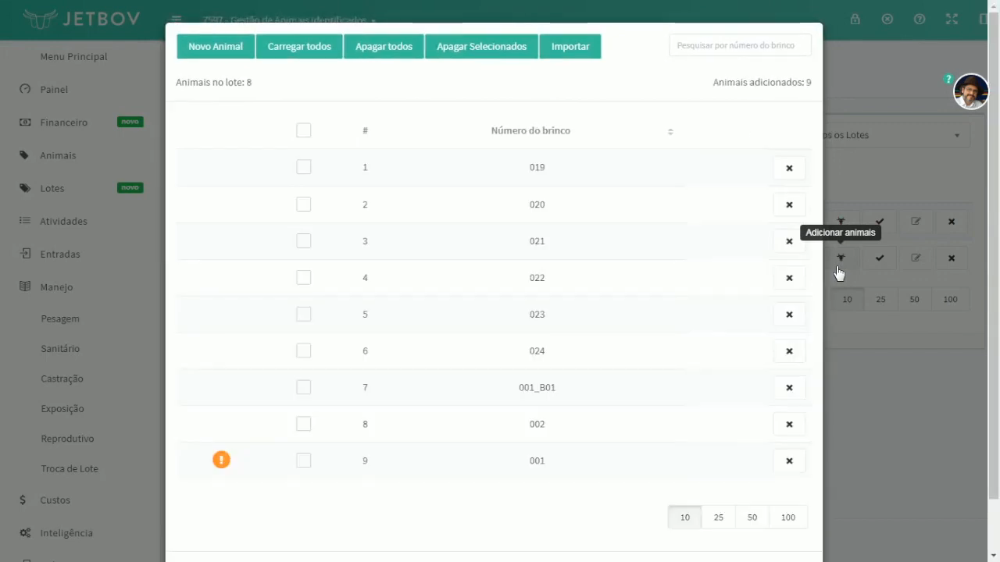

### V13 — Manejo de castração

[Assistir à demonstração](https://www.youtube.com/watch?v=e0JJuIRo2iQ) · 03:25 · publicada em 11/09/2017.

**Cadastro.** Data, lote e observações, seguidos da escolha dos machos manejados. O procedimento pode ter registros sanitários associados.

**Fluxo.** Criar uma operação pendente, incluir participantes, conferir e confirmar. Antes da confirmação a demonstração permite editar/excluir. A execução altera a informação de castração dos animais e compõe seu histórico; a confirmação é o marco de efetivação narrado.

**Distinção.** Castrado é uma característica/evento do animal. Não deve ser confundido com sexo, categoria produtiva, lote ou baixa do rebanho. Um grupo pode conter animais com características diferentes.

**Para o AgroManage — proposta.** Validar sexo e situação ativa; registrar data, responsável e eventuais procedimentos associados. A operação em lote precisa de resultado por animal e prevenção de duplicidade. O evento não deve depender apenas de uma observação textual. Decisões clínicas e indicação da intervenção ficam fora do escopo de uma cópia funcional da demonstração.

**Capturas reais**

**Cadastro castracao — [01:11](https://www.youtube.com/watch?v=e0JJuIRo2iQ&t=71s)**

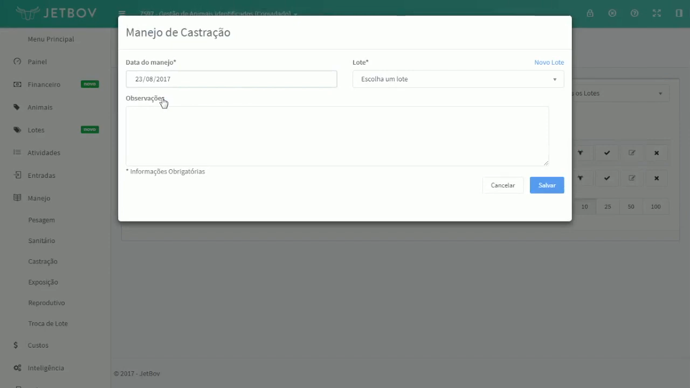

**Procedimento associado — [01:48](https://www.youtube.com/watch?v=e0JJuIRo2iQ&t=108s)**

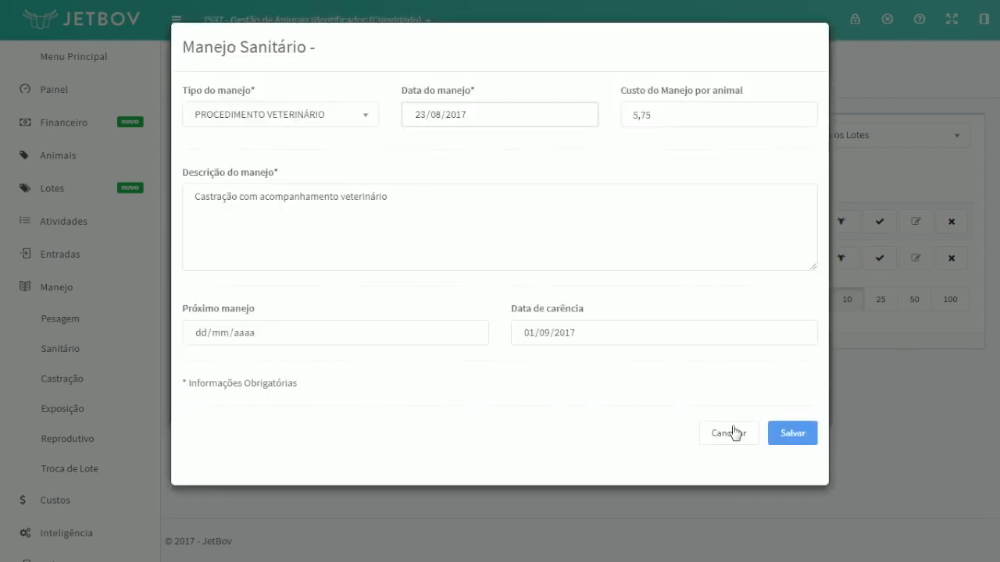

**Machos castracao — [02:01](https://www.youtube.com/watch?v=e0JJuIRo2iQ&t=121s)**

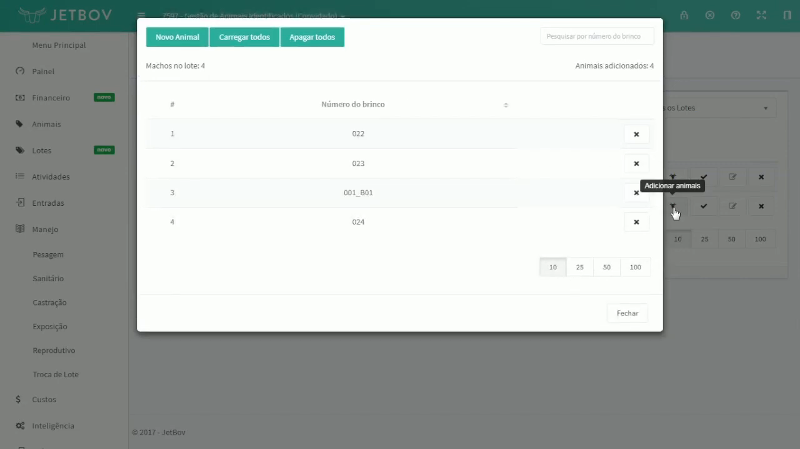

### V14 — Exposição reprodutiva em grupo

[Assistir à demonstração](https://www.youtube.com/watch?v=ijnqpwDr2sg) · 03:45 · publicada em 11/09/2017.

**Significado.** “Exposição” neste menu é exposição reprodutiva/cobertura. Não se trata de feira, exposição comercial ou movimentação de animais para evento.

**Campos visíveis/narrados.** Data, lote, período do dia (manhã/tarde/noite), identificação do touro ou sêmen, método de reprodução natural ou inseminação, final da estação de monta quando pertinente, responsável/veterinário e observações. O período do dia dessa tela é da cobertura, não de ordenha.

**Fluxo.** Cadastrar cabeçalho → selecionar fêmeas → acrescentar procedimentos associados quando aplicável → confirmar. O resultado é uma exposição registrada para cada fêmea, com reflexo em históricos e consultas reprodutivas. Exposta não equivale a prenhe: o diagnóstico é outra etapa.

**Para o AgroManage — proposta.** Modelar estação de monta, protocolo quando aplicável, método e reprodutor/material genético separadamente. Permitir cobertura coletiva mantendo resultados individuais e associar os diagnósticos à exposição correta. IATF e seus protocolos completos não estão demonstrados neste formulário apenas por existir a opção de inseminação.

**Capturas reais**

**Cabecalho exposicao — [00:49](https://www.youtube.com/watch?v=ijnqpwDr2sg&t=49s)**

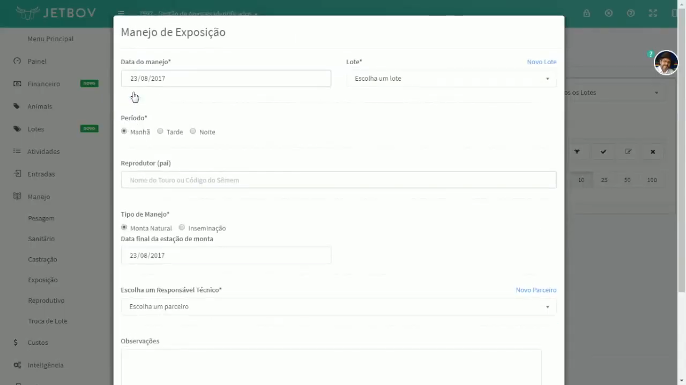

**Campos exposicao — [01:17](https://www.youtube.com/watch?v=ijnqpwDr2sg&t=77s)**

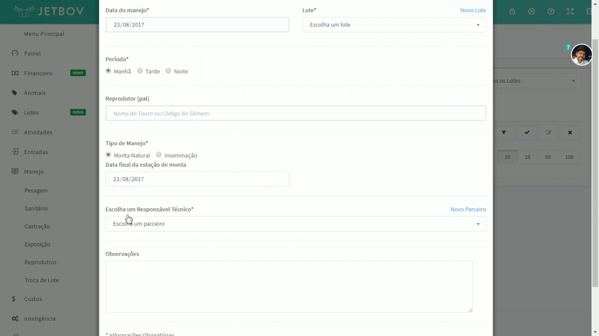

**Femeas expostas — [02:13](https://www.youtube.com/watch?v=ijnqpwDr2sg&t=133s)**

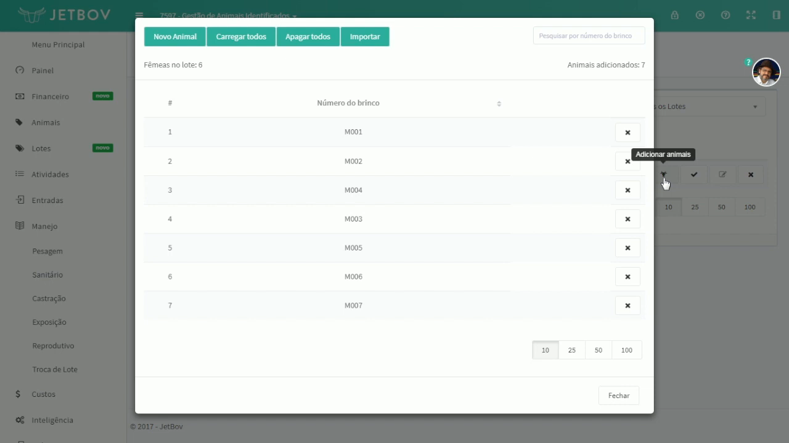

### V15 — Troca de lote

[Assistir à demonstração](https://www.youtube.com/watch?v=QDKoSFJKrM0) · 02:46 · publicada em 11/09/2017.

**Campos e fluxo.** Lote de destino, data, observações e escolha dos animais. A lista exibe a origem, permitindo conferir quais sairão de cada grupo. A troca fica pendente até confirmação; a demonstração mostra edição/exclusão de registros ainda não confirmados.

**Outros caminhos.** A narração cita mudanças de lote durante pesagem, manejo sanitário, castração, exposição e atividade no aplicativo de campo. São entradas alternativas para a mesma necessidade de movimentação rastreável.

**Distinção.** Trocar de lote produtivo não é necessariamente trocar de pastagem, mudar de fazenda, transferir propriedade, vender ou comprar. Uma interface pode facilitar operações combinadas, mas os efeitos devem ser explícitos.

**Para o AgroManage — proposta.** Histórico com origem, destino, data, autor e justificativa. Validar todos os participantes, a organização e a fazenda autorizada. Movimentos retroativos devem respeitar a sequência de entrada/saída e não deixar o animal simultaneamente em dois grupos exclusivos. Movimentação de um lote coletivo exige quantidade; a de animais identificados exige a relação de indivíduos.

**Capturas reais**

**Cadastro transferencia — [01:08](https://www.youtube.com/watch?v=QDKoSFJKrM0&t=68s)**

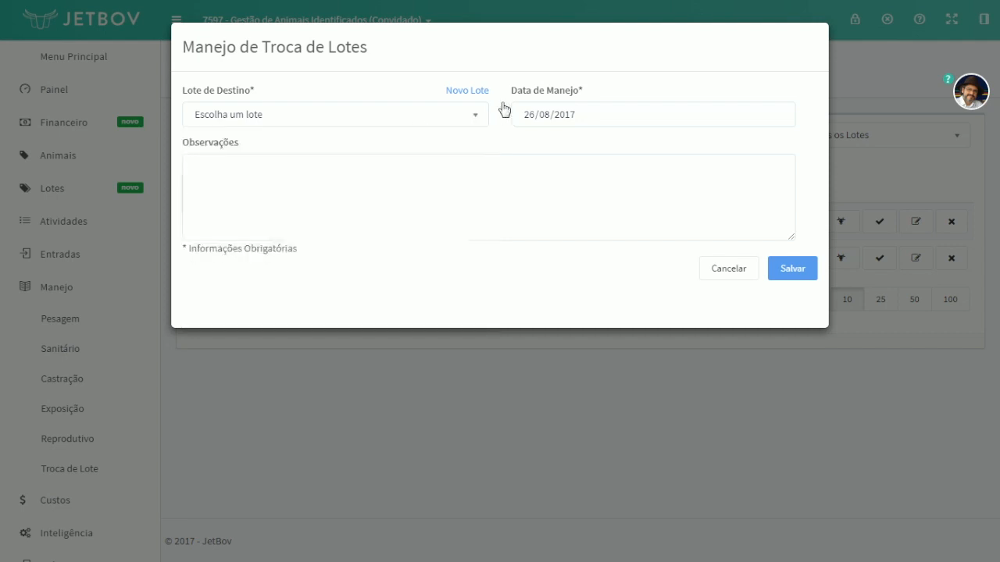

**Origem destino — [01:28](https://www.youtube.com/watch?v=QDKoSFJKrM0&t=88s)**

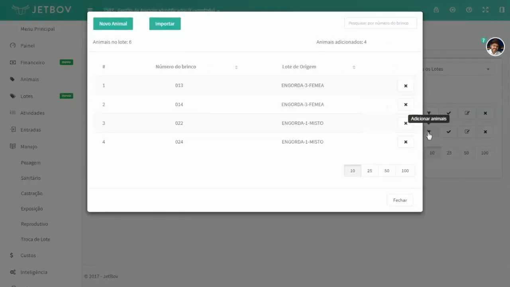

### V16 — Custos nutricionais por competência

[Assistir à demonstração](https://www.youtube.com/watch?v=lhpdset3NgU) · 02:38 · publicada em 11/09/2017.

**Escopo demonstrado.** Lançamento mensal de custos nutricionais, e não comprovação de um módulo completo de formulação de dieta ou almoxarifado.

**Cabeçalho e itens.** Mês/ano, lote específico ou todos, observações; linhas com tipo, item/produto, quantidade, unidade e preço unitário. A gravação mostra um exemplo de forragem e alimento selecionado. Os itens geram valor total a distribuir.

**Rateio.** A narração explica apropriação aos animais considerando o período de permanência e as datas de entrada. Não detalha todas as regras para saída, troca de lote, fração de dia e arredondamento. A gravação mostra salvar os lançamentos, sem demonstrar o mesmo fluxo de confirmar participantes dos manejos.

**Resultado.** Os custos passam a compor a visão econômica dos animais e as simulações de venda atual/futura.

**Para o AgroManage — proposta.** Separar consumo físico de insumo, custo apropriado e pagamento. O módulo atual já tem consumo com baixa de estoque: uma futura apuração mensal deve aproveitar esse custo e impedir duplicidade com lançamentos manuais. Definir método de rateio, competência e origem de cada valor; dieta planejada e fornecimento real são capacidades adicionais.

**Capturas reais**

**Competencia nutricional — [00:55](https://www.youtube.com/watch?v=lhpdset3NgU&t=55s)**

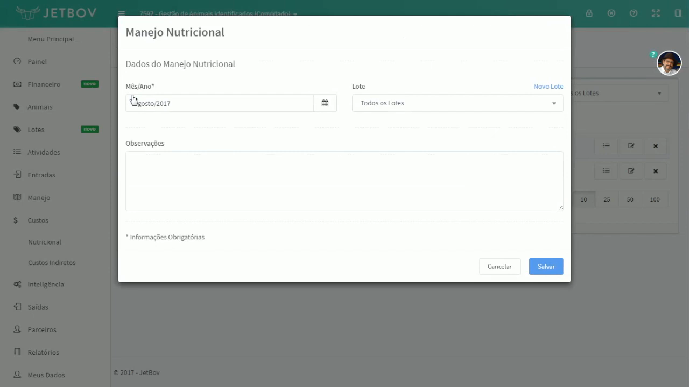

**Insumo nutricional — [01:33](https://www.youtube.com/watch?v=lhpdset3NgU&t=93s)**

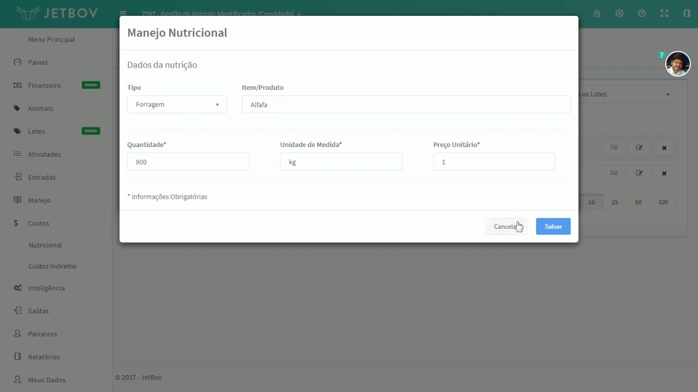

### V17 — Custos indiretos

[Assistir à demonstração](https://www.youtube.com/watch?v=0rl0r1G12AY) · 02:46 · publicada em 11/09/2017.

**Escopo e cadastro.** Registrar custos da fazenda não atribuídos a um único animal no momento do lançamento. Campos: mês/ano, categoria, parceiro opcional, descrição e valor. A listagem pode ser filtrada por intervalo, categoria e parceiro.

**Rateio narrado.** O montante é distribuído entre os animais da fazenda considerando sua permanência. Diferentemente do custo nutricional por lote, aqui a abrangência é geral. O vídeo não documenta detalhadamente regras de competência para todos os casos de movimentação.

**Uso.** Edição e remoção de lançamentos; composição de custos e resultados do rebanho. Reconhecer uma despesa no fluxo de caixa e apropriar um custo ao animal são operações relacionadas, mas não equivalentes.

**Para o AgroManage — proposta.** Reutilizar categorias e despesas do financeiro e acrescentar uma política explícita de apropriação. Guardar custo de origem, período, universo de animais, base de rateio e parcelas calculadas. O total das parcelas deve reconciliar com o lançamento. Não cobrar o mesmo gasto duas vezes por ele existir tanto no financeiro quanto na gestão pecuária.

**Capturas reais**

**Categorias custos — [01:18](https://www.youtube.com/watch?v=0rl0r1G12AY&t=78s)**

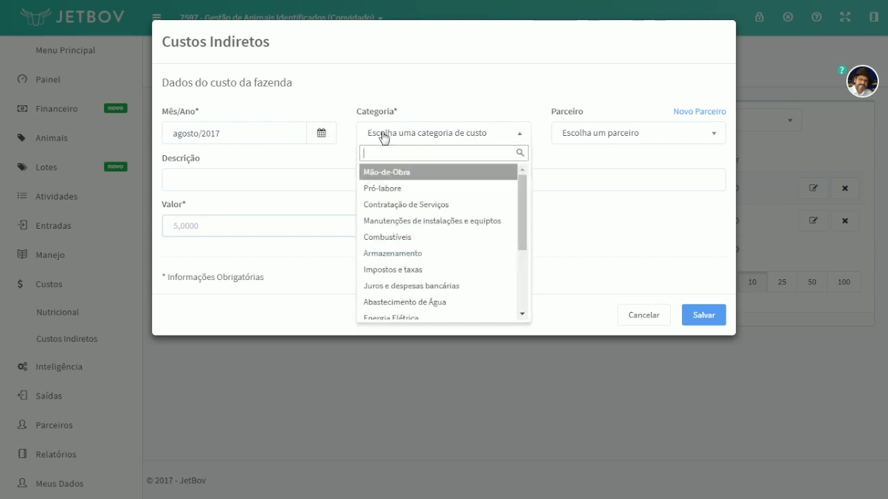

**Cadastro custo — [01:28](https://www.youtube.com/watch?v=0rl0r1G12AY&t=88s)**

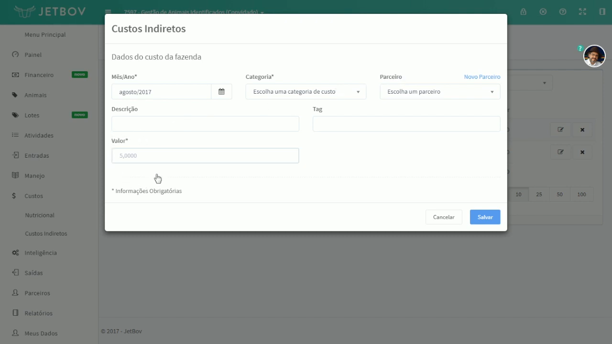

### V18 — Aplicativo de campo e aprovação das atividades

[Assistir à demonstração](https://www.youtube.com/watch?v=TmrelHluaMo) · 07:32 · publicada em 11/09/2017.

**Aplicativo histórico.** A gravação apresenta telas do celular dentro da própria demonstração. O primeiro acesso exige internet para autenticar e carregar os dados; mantendo a sessão, é possível realizar atividades sem conexão.

**Funções mostradas/narradas.** Escolher fazenda, pesquisar brinco, consultar atividades da lida, associar identificação eletrônica, trocar lote, registrar procedimento sanitário, morte/perda, nascimento e peso. Na pesagem há sequência de brinco, peso, visualização de desempenho, possível novo lote e salvar/próximo animal. A configuração menciona leitor/balança Bluetooth, com particularidades da apresentação Android.

**Sincronização.** Finalizar a lida habilita seu envio; a narração menciona tentativas periódicas de 15 minutos e sincronização manual. Indicadores de enviado/recebido não significam que o manejo já foi aprovado.

**Conferência web.** Em “Atividades”, o responsável revisa os registros e aprova/rejeita individualmente ou em conjunto. A incorporação oficial ocorre na etapa de aprovação descrita, não apenas no upload.

**Para o AgroManage — proposta.** Tratar offline como projeto próprio: identidade local do evento, fila persistente, reenvio idempotente, conflitos, permissão e trilha de auditoria. Não prometer compatibilidade com dispositivos só pela existência do formulário web. As capturas são quadros da gravação original, incluindo sua moldura/apresentação.

**Capturas reais**

**Envio sincronizacao — [03:02](https://www.youtube.com/watch?v=TmrelHluaMo&t=182s)**

**Manejos mobile — [04:58](https://www.youtube.com/watch?v=TmrelHluaMo&t=298s)**

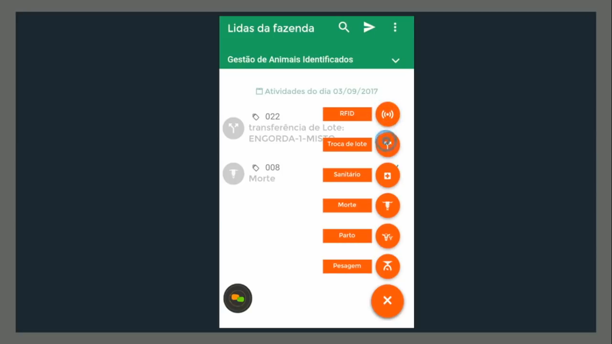

**Pesagem mobile — [05:27](https://www.youtube.com/watch?v=TmrelHluaMo&t=327s)**

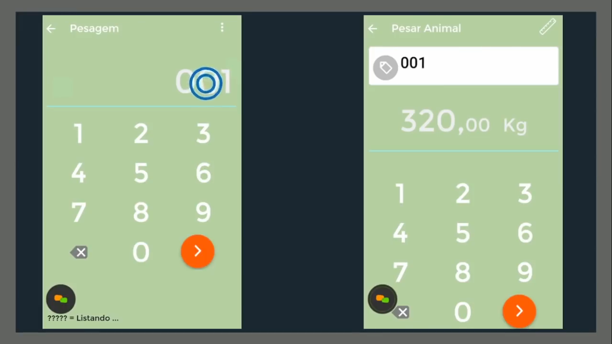

**Aprovacao web — [06:54](https://www.youtube.com/watch?v=TmrelHluaMo&t=414s)**

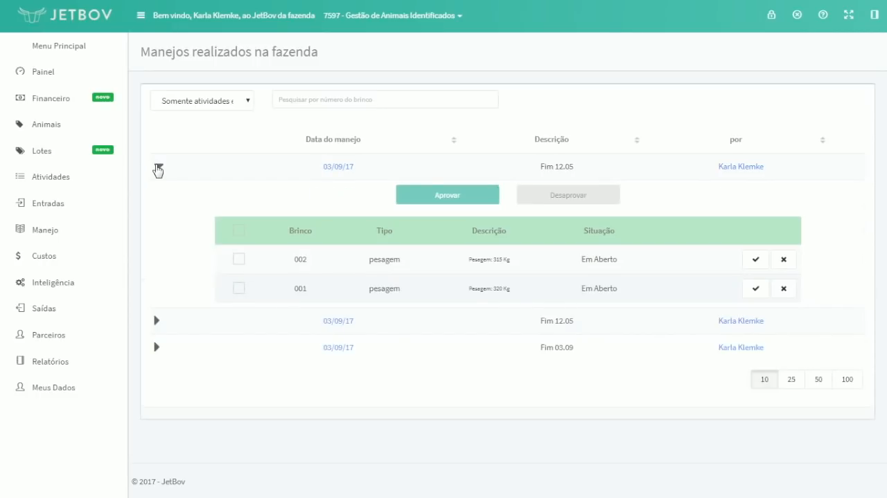

### V19 — Manejo reprodutivo: ciclo da matriz e do bezerro

[Assistir à demonstração](https://www.youtube.com/watch?v=mNREwEhFpeA) · 08:25 · publicada em 11/09/2017.

**Visão geral.** Indicadores de vacas prenhas, taxa de prenhez, parição e desmame. A listagem permite pesquisar brinco e filtrar lote e estados reprodutivos; aparecem idade, último peso, situação, previsão de parto e identificação do bezerro.

**Etapas e campos.** Exposição: data, método e touro/sêmen, com responsável/veterinário quando aplicável. Diagnóstico: data do exame, resultado prenhe/vazia e previsão de parto. Parto: abre cadastro do bezerro com lote, sexo, data de nascimento/entrada, peso e identificação; cria vínculo com a matriz. A apresentação permite registrar parto sem necessariamente ter lançado as etapas anteriores. Após o parto, a matriz aparece lactante.

**Desmame.** Data do desmame, número do brinco, peso e lote de destino do bezerro. A narração descreve a mudança do estado da mãe ao concluir esse fluxo. No uso leiteiro, desmamar o bezerro não deve, por pressuposto, encerrar a lactação da vaca: a regra de corte demonstrada precisa ser adaptada ao sistema produtivo.

**Outras situações.** Aborto/perda e cancelamento do histórico reprodutivo corrente são mencionados. O aplicativo pode gerar identificação inicial do bezerro baseada na mãe/data; isso é uma convenção histórica, não regra universal.

**Limite da evidência.** As fórmulas completas dos indicadores não ficam suficientemente definidas pela narração/legenda, especialmente seus denominadores e períodos. Lactante é um estado apresentado aqui; não há registro de litros, ordenhas ou qualidade do leite neste vídeo.

**Para o AgroManage — proposta.** Encadear cobertura, diagnóstico, gestação, parto, bezerro, desmame e perdas, com histórico e correções. Separar estado reprodutivo de lactação para suportar leite. Decidir como registrar histórico inicial incompleto sem fabricar uma cobertura/gestação inexistente na documentação.

**Capturas reais**

**Indicadores reproducao — [01:45](https://www.youtube.com/watch?v=mNREwEhFpeA&t=105s)**

**Exposicao individual — [03:56](https://www.youtube.com/watch?v=mNREwEhFpeA&t=236s)**

**Diagnostico — [05:01](https://www.youtube.com/watch?v=mNREwEhFpeA&t=301s)**

**Cadastro bezerro — [05:34](https://www.youtube.com/watch?v=mNREwEhFpeA&t=334s)**

**Desmame — [06:39](https://www.youtube.com/watch?v=mNREwEhFpeA&t=399s)**

### V20 — Simulador de venda e resultado econômico

[Assistir à demonstração](https://www.youtube.com/watch?v=pO9AeLP7buY) · 04:42 · publicada em 11/09/2017.

**Parâmetros.** Lote, preço por kg, modalidade peso vivo/carcaça, custos adicionais por mês e meta de lucro. A interface permite variar preço, rendimento de carcaça, GMD projetado e horizonte em dias.

**Resultados.** Situação atual e futura, resultado, margem, custo por arroba e tabela por animal. A tabela inclui identificação, raça, GMD, aquisição, peso atual/projetado, peso de carcaça quando selecionado, valor de venda, custos e resultado. Cores diferenciam prejuízo, resultado abaixo da meta e objetivo atingido.

**Interpretação.** A projeção depende das hipóteses informadas; ela não é previsão garantida. Selecionar carcaça no simulador não comprova que a coleção mostre todo o acerto de um abate real. A demonstração compara cenários econômicos, não registra automaticamente recebimento.

**Para o AgroManage — proposta.** Exibir premissas e período, guardar cenários e explicar a composição dos custos. Distinguir massa viva, rendimento, peso de carcaça, preço por kg e por arroba. Definir a fórmula de margem e a base do custo/@ antes de implementar; a legenda não permite afirmar uma fórmula exata para todos os indicadores da versão histórica. Um cenário só vira venda por ação explícita em um fluxo de negócio próprio.

**Capturas reais**

**Parametros simulacao — [01:01](https://www.youtube.com/watch?v=pO9AeLP7buY&t=61s)**

**Resultado atual — [01:36](https://www.youtube.com/watch?v=pO9AeLP7buY&t=96s)**

**Projecao venda — [04:16](https://www.youtube.com/watch?v=pO9AeLP7buY&t=256s)**

### V21 — Fluxo de caixa

[Assistir à demonstração](https://www.youtube.com/watch?v=99AIW1RnbIg) · 01:39 · publicada em 11/09/2017.

**Organização.** A página apresenta recebimentos pendentes do mês, gráfico de entradas/saídas/saldo em horizonte de 12 meses e pagamentos pendentes do mês. Metas de venda definidas nos lotes também contribuem para a visão de planejamento mencionada na narração.

**Origens.** Aquisições, vendas de animais vivos, operações de saída/abate e lançamentos manuais a pagar/receber alimentam a visão financeira descrita. Registros já liquidados deixam de compor as listas de pendências; isso não significa que devam desaparecer do extrato.

**Distinção.** Receita prevista, título a receber e dinheiro recebido são estados diferentes. Uma projeção de venda não deve ser apresentada como disponibilidade em caixa.

**Para o AgroManage — proposta.** Reaproveitar o financeiro da aplicação e vincular os documentos bovinos a ele. Filtros por fazenda/período, projeção versus realizado e navegação do gráfico para os títulos de origem. Se metas de lotes aparecerem no planejamento, identificá-las como hipótese comercial para não duplicar uma venda já faturada.

**Capturas reais**

**Fluxo caixa — [00:46](https://www.youtube.com/watch?v=99AIW1RnbIg&t=46s)**

**Detalhe caixa — [01:08](https://www.youtube.com/watch?v=99AIW1RnbIg&t=68s)**

### V22 — Contas a pagar, a receber e extrato

[Assistir à demonstração](https://www.youtube.com/watch?v=E4LvL-wZRZU) · 05:35 · publicada em 11/09/2017.

**Navegação.** Adicionar pagamento, contas a pagar, contas a receber, extrato e importação por planilha. A interface diferencia visualmente pagar/receber e permite filtrar períodos, tipos, situação e palavras-chave.

**Campos do título a pagar.** Referência, vencimento, valor, parceiro, repetição, intervalo em dias, quantidade de repetições, marcação de pago, palavras-chave e observação; a tela também apresenta indicação de compra de animal. O vídeo demonstra recorrência e horizonte de geração.

**Recebimento e baixa.** O fluxo a receber contém referência, vencimento, valor e parceiro, opções de parcelas e confirmação de recebido. Ao liquidar, são informados dados do recebimento efetivo, como valor e data. A demonstração permite editar/remover pendências e mostra opções antigas de exclusão; isso não deve ser copiado sem regras de auditoria.

**Extrato.** Lançamentos de entrada e saída, totais, saldo e identificação de vencidos, com impressão/exportação. Previsto e realizado precisam ser interpretados separadamente.

**Para o AgroManage — proposta.** Integrar ao financeiro existente. Formalizar recorrência versus parcelamento, vencimento versus data da baixa, pagamentos/recebimentos parciais, reversão e reconciliação. Não recriar um financeiro independente dentro do menu de bovinos.

**Capturas reais**

**Conta pagar — [01:54](https://www.youtube.com/watch?v=E4LvL-wZRZU&t=114s)**

**Recorrencia — [02:15](https://www.youtube.com/watch?v=E4LvL-wZRZU&t=135s)**

**Recebimento efetivo — [03:40](https://www.youtube.com/watch?v=E4LvL-wZRZU&t=220s)**

**Extrato — [05:05](https://www.youtube.com/watch?v=E4LvL-wZRZU&t=305s)**

### V23 — Venda de boi vivo, confirmação e estorno

[Assistir à demonstração](https://www.youtube.com/watch?v=NChaKpEJ2Ak) · 05:16 · publicada em 11/09/2017.

**Cabeçalho.** Data, referência, comprador, quantidade, forma de precificação por kg/cabeça, preço, frete, opção GTA e observações. Para o modo coletivo aparecem quantidades por sexo e lote; no identificado a relação dos animais é incluída na operação.

**Fluxo.** Criar venda pendente → adicionar animais/conferir pesos e valores → confirmar. A confirmação efetiva a saída do rebanho e a apresentação oferece integração com contas a receber. Gerar um recebível não equivale a considerar a venda paga. Registros pendentes podem ser editados/excluídos.

**Estorno.** A versão histórica demonstra retorno de animais a um lote identificado pelo estorno/referência. Trata-se de reversão de uma saída confirmada, distinta de apagar o documento. A operação precisa conservar a rastreabilidade e seus efeitos financeiros.

**Documentos e consulta.** Romaneio, exportação e referências a anexos SISBOV; o envio de romaneio por e-mail é uma função apresentada. A listagem permite consultar confirmadas/pendentes, comprador e referência; o desempenho continua consultável para animais vendidos.

**Distinção de saídas.** Venda por peso vivo, transferência entre fazendas e remessa/acerto de abate não são a mesma operação. A narração cita esses caminhos, mas este vídeo não detalha todo o processo de abate nem autoriza inferir transferência automática entre organizações.

**Para o AgroManage — proposta.** Documento de venda com baixa de indivíduos/saldo, custo histórico, frete e recebível, confirmado atomicamente. Estorno também precisa reverter efeitos relacionados de forma consistente e auditável.

**Capturas reais**

**Cadastro venda — [01:08](https://www.youtube.com/watch?v=NChaKpEJ2Ak&t=68s)**

**Gta venda — [01:48](https://www.youtube.com/watch?v=NChaKpEJ2Ak&t=108s)**

**Confirmacao venda — [02:28](https://www.youtube.com/watch?v=NChaKpEJ2Ak&t=148s)**

**Estorno venda — [03:08](https://www.youtube.com/watch?v=NChaKpEJ2Ak&t=188s)**

## 5. Fluxos transversais que orientam a implementação

### 5.1 Operação preparada versus operação efetivada

Uma característica recorrente das demonstrações é separar preparação e confirmação. O registro do cabeçalho não significa, por si só, que todo o lote foi manejado ou que o rebanho já mudou.

Esse padrão é especialmente visível em compra, pesagem, sanidade, castração, exposição, troca de lote e venda. Não deve ser imposto indiscriminadamente: os vídeos de custos mensais e títulos financeiros mostram outros formatos de gravação/baixa.

**Requisitos propostos para o AgroManage:**

1. Guardar a data do fato separada das datas de criação, confirmação e eventual estorno.
2. Congelar os participantes efetivos ao confirmar; o lote pode mudar de composição depois.
3. Revalidar permissões, organização/fazenda, situação e dados dos participantes no servidor.
4. Aplicar efeitos relacionados atomicamente: animais, pesos, lotes, consumo, custos e financeiro, conforme a operação.
5. Tornar a confirmação idempotente: duplo clique/reenvio não pode gerar dois pesos, duas baixas ou dois recebíveis.
6. Corrigir operações efetivadas por eventos rastreáveis; não apagar silenciosamente o passado.
7. Informar o que ocorrerá antes de confirmar, incluindo mudança de lote e geração de título financeiro.

### 5.2 Campo e sincronização

**Enviado, recebido e aprovado são estados diferentes.** O vídeo 18 evidencia essa separação. Um futuro aplicativo do AgroManage precisa suportar reenvio sem duplicidade, eventos fora de ordem e dados alterados no servidor durante a operação offline. A fila deve preservar a autoria e a origem, sem permitir que a sincronização amplie permissões.

### 5.3 Relações entre documentos, eventos e entidades

| Origem | Entidades/eventos afetados | Conferência necessária |
|---|---|---|
| Compra | Documento, animais/saldo, origem, custo e eventual obrigação financeira | Identificação, quantidade, preço, frete e situação |
| Pesagem | Animal, medição, GMD e eventual transferência | Data, peso individual e último peso cronológico |
| Sanidade | Aplicações, custo, carência, agenda; estoque se integrado | Participantes, produto/unidade e período de restrição |
| Troca de lote | Histórico de composição do grupo | Origem, destino, data e não duplicidade |
| Parto | Matriz, gestação, evento e bezerro | Resultado, vínculo parental e identificação |
| Desmame | Bezerro, peso, grupo de destino e ciclo da matriz | Política específica para corte versus leite |
| Venda | Documento, baixa do rebanho, resultado e recebível | Peso/modalidade, comprador e reversão consistente |
| Custo mensal | Fonte, competência e parcelas apropriadas | Reconciliação e ausência de dupla contabilização |

## 6. Dicionário funcional consolidado para planejamento

Os grupos abaixo são uma **proposta de modelagem**, inspirada nas demonstrações e nas estruturas existentes do AgroManage. A coluna de referência indica a origem da necessidade; não significa que todos os campos propostos tenham aparecido no vídeo. Identificadores internos, auditoria, estados e validações são decisões de implementação a detalhar.

| Entidade/fluxo | Dados a considerar | Referência | Relações e cuidados |
|---|---|---|---|
| Fazenda | Nome, localização/endereço, hectares, documentos opcionais, coordenadas | V03 | Reutilizar fazenda da organização; área de pastagem não é necessariamente a área total da propriedade |
| Acesso | Usuário, fazendas autorizadas, capacidades, situação do convite | V04 | Reutilizar autenticação/autorização; custos e confirmações com permissão própria |
| Parceiro | Nome, papéis, documentos, contatos, endereço, notas | V05 | Uma pessoa pode ter mais de um papel; não equivale a usuário autenticado |
| Área/pasto | Fazenda, nome, área, geometria opcional, capacidade UA/ha, notas | V06 | Histórico de ocupação separado do cadastro físico |
| Lote de manejo | Fazenda, nome, modo individual/coletivo, fase, pasto/contexto, metas | V07–08 | Saldo coletivo e membros identificados devem ter regras explícitas de agregação |
| Animal | Brinco, identificações adicionais, sexo, nascimento, raça, categoria, castração, origem, entrada, genealogia, situação | V08 | Nascimento e entrada são datas distintas; documentação opcional conforme finalidade |
| Aquisição | Referência, data, produtor, precificação, frete, GTA, notas, participantes e situação | V10 | Diferenciar compra de cadastro inicial; ligar ao financeiro conforme regra |
| Pesagem | Data, animal, peso kg, motivo, origem do dado, manejo | V11 | Peso retroativo não substitui peso atual mais recente; evitar medições duplicadas |
| Manejo coletivo | Tipo, data, contexto/lote, participantes, autor, conferência e situação | V11–15 | Reutilizar estrutura onde fizer sentido sem criar abstração excessiva |
| Procedimento sanitário | Tipo, produto/aplicação, dose/unidade, data, responsável, custo, próxima aplicação, restrições | V12 | Produto/lote/dose são ampliação proposta; carência e custo aparecem na demonstração |
| Cobertura/exposição | Matriz(es), método, data, período, touro/sêmen, estação, responsável | V14 e V19 | Resultado de gestação é outro registro; protocolos completos exigem desenho próprio |
| Diagnóstico | Matriz, exposição/gestação, data do exame, resultado, previsão de parto | V19 | Resultado vazio não deve apagar exposição; nova avaliação preserva histórico |
| Parto e bezerro | Matriz, gestação quando conhecida, data, resultado, bezerro, sexo, peso, identificação e lote | V19 | Histórico inicial pode estar incompleto; prever natimorto/múltiplos conforme escopo validado |
| Desmame | Bezerro, data, peso, identificação e lote de destino; relação com a matriz | V19 | Desmame e secagem são eventos diferentes, sobretudo no leite |
| Nutrição/custo direto | Competência/período, lote/animais, produto, quantidade, unidade, preço, fonte e rateio | V16 | Reconciliar com consumo/estoque existente; não repetir custo |
| Custo indireto | Competência, categoria, parceiro, descrição, valor e regra de apropriação | V17 | Despesa de origem e parcelas apropriadas com rastreabilidade |
| Atividade de campo | Dispositivo/origem, identificador local, fato, participantes, envio, recepção, aprovação/rejeição | V18 | Proposta técnica para reproduzir o fluxo; idempotência e conflitos são essenciais |
| Simulação | Data-base, grupo, modalidade, preço, rendimento, GMD, dias, custos futuros e meta | V20 | Cenário versionado; não movimenta caixa nem rebanho |
| Venda | Referência, data, comprador, modalidade, animais/quantidade, pesos, preço, frete, GTA e situação | V23 | Venda, faturamento e recebimento distintos; reversão com efeitos consistentes |
| Título financeiro | Origem, natureza, parceiro, vencimento, valor, parcelas/recorrência e baixas | V21–22 | Integrar ao financeiro existente; não criar contas paralelas no bovino |
| Ordenha/lactação | Vaca, ciclo, data/turno, litros, descarte, motivo e destino | Extensão própria | Parte básica já existe no AgroManage; não observada nos vídeos da coleção |

Em todos os registros de negócio, preservar o vínculo de organização/fazenda, autoria e trilha temporal segundo os padrões atuais do projeto. Quantidades e valores exigem precisão decimal e unidade explícita; não reutilizar um campo numérico sem distinguir cabeças, kg, litros, hectares, UA e reais.

## 7. Indicadores e fórmulas: o que está claro e o que falta definir

### 7.1 Convenções verificadas na explicação

- **GMD:** a apresentação relaciona ganho de peso ao intervalo entre pesagens. Para implementação, a forma usual `(peso posterior − peso anterior) / dias transcorridos` só é válida com duas medições comparáveis e intervalo positivo. A escolha do par de pesagens e o tratamento de medições no mesmo dia precisam estar documentados; o vídeo não especifica todas as exceções.
- **Unidade animal na demonstração:** 1 UA = 450 kg de peso vivo (V06). Nessa convenção, `UA = peso vivo agregado / 450`; `lotação UA/ha = UA / hectares`; `ocupação % = lotação atual / lotação máxima × 100`. A gravação apresenta arredondamento de ocupação para exibição. Não transformar esse arredondamento em perda de precisão nos dados.
- **Custo nutricional/indireto:** a narração descreve apropriação considerando permanência e datas de entrada (V16–17). Ela não fornece algoritmo completo de rateio para entradas/saídas/trocas; a regra final não está comprovada apenas pelo exemplo.

### 7.2 Fórmulas sugeridas para discussão — não atribuídas como regra exata da JetBov

| Indicador | Base proposta | Decisão pendente |
|---|---|---|
| Peso futuro | Peso-base + GMD projetado × dias | Horizonte, limites e origem do GMD |
| Carcaça estimada | Peso vivo projetado × rendimento informado | É estimativa; separar do peso real do frigorífico |
| Receita estimada | Quantidade comercializável × preço na unidade escolhida | Kg vivo, kg carcaça, arroba ou cabeça |
| Resultado econômico | Receita − custos apropriados pertinentes | Inclusão de frete, impostos/comissões e custos futuros |
| Margem sobre receita | Resultado / receita × 100 | Não confundir com retorno sobre custo; receita zero não gera percentual válido |
| Custo por arroba | Custo / (peso de referência / 15 kg) | Qual peso: vivo, carcaça, ganho produzido ou outro? Tornar o rótulo explícito |
| Taxa de prenhez | Matrizes prenhes / fêmeas elegíveis da coorte × 100 | Coorte, período, exposições e exclusões |
| Taxa de parição/desmame | Eventos/animais de resultado / população-base definida × 100 | Nascidos vivos, fêmeas expostas, matrizes paridas e perdas não são denominadores intercambiáveis |
| Litros comercializáveis | Produção − descarte | Destino a bezerros, uso interno e ajuste de tanque, se aplicável |

Indicadores do painel e relatórios devem informar período, fazenda, base do cálculo, qualidade/idade dos dados e tratamento de registros retroativos. Uma taxa sem denominador definido não é um requisito pronto para desenvolvimento.

## 8. Relação com o módulo bovino atual do AgroManage

### 8.1 Base examinada

A comparação abaixo se refere ao código presente neste workspace na data da revisão, não a uma auditoria completa de todos os módulos da aplicação. Foram consultados o contrato bovino documentado e os serviços, seletores, serializers, views e formulário principal diretamente relacionados:

- [Contrato da API bovina](docs/ai/api.md), seção “Bovine workspace (beef and dairy)”.
- [Serviços de operações bovinas](backend/apps/livestock/cattle_services.py).
- [Seletores e visão geral](backend/apps/livestock/cattle_selectors.py).
- [Serializers e validações](backend/apps/livestock/cattle_serializers.py).
- [Endpoints bovinos](backend/apps/livestock/cattle_views.py).
- [Interface principal bovina](frontend/src/components/cattle/CattleWorkspace.tsx).
- [Cliente da API](frontend/src/services/cattleService.ts).

**Esta revisão produziu documentação e imagens; não alterou os módulos da aplicação.** “Não presente no fluxo bovino examinado” não significa ausência absoluta de infraestrutura equivalente em outro domínio do projeto. Financeiro, estoque, pessoas e permissões existentes devem ser aproveitados antes de criar novas estruturas.

### 8.2 Matriz de cobertura e lacunas

| Capacidade | Situação na base bovina examinada | Próxima evolução proposta | Prioridade |
|---|---|---|---|
| Animais identificados | Cadastro, filtros, peso, histórico e relações parentais disponíveis | Completar origem/documentos e ficha por abas apenas conforme necessidade | P1 |
| Lotes coletivos | Quantidade, fases e histórico de mudança de fase | Entradas/saídas parciais e eventual individualização com reconciliação auditável | P0 |
| Inventário/visão geral | Contagem sem duplicidade, listas, resumos e CSV gerencial | Agrupamentos etários/peso, alertas, relatórios reproduzíveis | P1 |
| Pesagem individual | Registro persistido e proteção do peso atual contra lançamento retroativo | Manejo coletivo com rascunho, grade de participantes e confirmação | P0 |
| Sanidade | Vacinação e histórico; possibilidade de vínculo com estoque | Manejo coletivo, agenda e carências explícitas por finalidade | P0 |
| Castração | Existe evento histórico para machos | Verificar se todos os consumidores têm um estado persistido de castrado, além do evento | P1 |
| Reprodução | Cobertura/IA, diagnóstico, gestação, parto e perdas | Estação/protocolo e operação coletiva; separar reprodução de lactação | P0 |
| Parto com histórico incompleto | Serviço atual exige gestação confirmada válida | Definir fluxo de cadastro histórico sem inventar informação anterior | P1 |
| Desmame | Evento atual altera categoria do bezerro | Fluxo ligado à matriz, peso e lote; política própria para corte/leite | P0 |
| Pastagens | Nome, hectares e notas; ocupação por lote e fechamento | Capacidade UA/ha, indicadores e posteriormente geometria/mapa | P1; mapa P2 |
| Mudança de grupo/local | Há fase de lote e ocupação de pastagem | Conferir cobertura de transferência individual e coletiva com origem/destino | P0 |
| Nutrição | Consumo com estoque e custo capturado atomicamente | Apuração por período e rateio sem duplicar o custo já consumido | P1 |
| Custos indiretos | Não identificado rateio pecuário completo no fluxo examinado | Conectar despesas existentes à apropriação por animal/lote/competência | P1 |
| Venda | Lote inteiro/parcial por kg vivo, usando serviço existente de receita | Venda de identificados, rascunho/confirmação, modalidade, frete, recebível e estorno | P0 |
| Financeiro | Integração existente reutilizada na venda coletiva | Separar venda, título e baixa; verificar recursos existentes antes de ampliar | P0 |
| Simulador | Não identificado na API/interface bovina examinada | Cenário atual/futuro com premissas, custos rastreáveis e metas | P2 |
| Leite | Produção/descarte por vaca, data e turno; evita duplicidade do turno | Ciclo de lactação, carência, destino, tanque, qualidade e comercialização | P0/P1 |
| Offline e dispositivos | Não implementados nessa versão bovina | Projeto próprio de sincronização, conferência e integrações | P2 |
| Permissões/organização | Escopo de organização e espécie, restrições de mutação/valores existentes | Preservar e estender capacidades pontuais para confirmar/estornar/exportar | P0 |

**Prioridades sugeridas:** P0 = integridade e ciclo operacional básico; P1 = gestão mais completa e apuração; P2 = especialização e produtividade avançada. Essa ordem é proposta de trabalho, não compromisso de prazo.

### 8.3 Observações específicas do código que exigem decisão

1. O parto atual exige fêmea ativa gestante e uma gestação válida; a demonstração histórica admite registrar nascimento com histórico anterior incompleto. Precisamos escolher um fluxo de importação/cadastro inicial que preserve a honestidade dos dados.
2. O evento de desmame atual muda “Bezerro” para “Novilha” ou “Garrote”. Ele ainda não representa, sozinho, o formulário completo de mãe/bezerro, peso e lote visto no V19.
3. O evento de castração atual valida macho e registra histórico. A revisão do serviço não mostrou uma atualização explícita de atributo de castração nesse evento; conferir consumidores e estado desejado antes de acrescentar filtros/relatórios baseados nele.
4. O registro atual de leite exige vaca/matriz ativa e valida produção/descarte/duplicidade por turno. Isso é uma base de coleta, não comprovação de ciclo completo de lactação, qualidade e faturamento do leite.
5. O estado reprodutivo é usado como campo principal para exibição e validação em vários fluxos. Para leite, gestação e lactação podem coexistir e precisam de representação compatível, sem regressão nas operações de corte.
6. O formulário de venda coletiva informa “registrar venda e receita”. Antes de ampliar modalidades, mapear a semântica financeira do serviço reutilizado para não tratar uma venda a prazo como dinheiro já recebido.

## 9. Ampliação para pecuária leiteira — proposta própria

Esta seção atende ao objetivo de cobrir também leite. **As funcionalidades abaixo não foram demonstradas nos 23 vídeos revisados.** São requisitos candidatos a discutir para o AgroManage, aproveitando a base de ordenhas que já existe.

### 9.1 Lactação e produção

- Ciclo de lactação vinculado à vaca e ao parto quando conhecido; data inicial, número da lactação, dias em lactação e encerramento/secagem. Permitir informar um ciclo inicial sem fabricar um parto passado.
- Registro por ordenha/turno e total diário, com litros produzidos, descartados, destinados ao bezerro/uso interno e comercializáveis, conforme o nível de detalhe escolhido.
- Motivo de descarte e vínculo com tratamento/carência; não permitir contabilizar leite restrito como liberado para comercialização sem regra explícita de liberação.
- Reprodução em paralelo: a vaca pode estar lactante e gestante. Desmame do bezerro não encerra automaticamente a lactação; secagem é evento próprio.
- Indicadores de produção diária, média por vaca em lactação, acumulado do ciclo e persistência; explicar animais/períodos considerados.

### 9.2 Tanque, coleta e qualidade

- Tanque/local de armazenamento, entradas consolidadas e coleta pelo comprador, com data, volume, destino e comprovante.
- Reconciliação entre ordenhas, descarte, consumo interno, tanque e volume coletado; diferenças precisam de motivo e autorização, sem ajuste silencioso dos registros originais.
- Resultados de análises e unidades, por exemplo gordura, proteína, CCS e CBT, com data e laboratório/origem. Limites, exigências e interpretação técnica dependem de definição posterior; não são prescritos por este relatório.
- Restrições por sanidade com períodos separados para leite e abate, quando cabíveis ao produto/procedimento registrado.

### 9.3 Comercialização e custos do leite

- Entrega/coleta, comprador, período, volume aceito, preço, adicionais/descontos e documento de acerto.
- Recebível no financeiro e baixa na data real; conciliar adiantamentos e ajustes quando fizerem parte da operação.
- Custo alimentar e outros custos por vaca/lote/litro, com método transparente para leite descartado e uso interno.
- Comparativos por período e lote, sem misturar litros, cabeças e kg em um único indicador.

A versão de corte e a leiteira devem compartilhar cadastros, sanidade, estoque e financeiro, com campos e fluxos especializados ativados conforme a produção da fazenda. Não é necessário duplicar o rebanho ou criar módulos financeiros concorrentes.

## 10. Diretrizes de interface para o AgroManage

A JetBov é referência funcional nesta análise. A interface do AgroManage deve seguir o estilo já existente e os ajustes de dimensão aprovados pelo usuário.

- Conteúdo da página com largura e espaçamento compatíveis com telas menores, títulos e ações alinhados, sem exigir zoom de 75% no navegador.
- Formulários extensos organizados em seções/abas ou página de cadastro, com rolagem natural e ações acessíveis; evitar formulários cortados em cartões/modais de altura fixa.
- Na ficha animal: identificação/origem, desenvolvimento/pesagens, sanidade/carências, reprodução/genealogia, custos e histórico. Exibir apenas o que a permissão autoriza.
- Em manejos coletivos: contexto e data no topo, participantes em grade, resumo do impacto e confirmação. Não presumir que selecionar lote significa selecionar todos os animais.
- Nas tabelas: colunas essenciais primeiro, unidades no cabeçalho, detalhes em ficha/painel; nomes longos abreviados visualmente com acesso ao valor completo. Truncar na tela não deve cortar o valor persistido ou o exportado.
- Estados vazios, carregamento, erros por linha, acesso restrito e confirmação/estorno devem seguir os padrões da aplicação.
- Suporte/configurações ao final do fluxo do menu, podendo alinhar ao fundo quando houver espaço, sem sobreposição fixa. Planos e assinatura permanecem nas configurações da organização.
- Campos avançados/documentais opcionais não devem tornar obrigatório um cadastro excessivo para uma operação simples. Cada obrigatoriedade precisa vir de necessidade de negócio definida.

## 11. Pacotes de trabalho sugeridos e critérios de aceite

### Pacote A — integridade do rebanho e dos manejos

**Entregas candidatas:** operação coletiva com participantes, confirmação idempotente, histórico de movimento, aquisição e venda com estados claros e estorno.

**Critérios a validar:** reenvio não duplica efeitos; seleção parcial não altera todo o lote; transferência conserva saldos; individualização não duplica cabeças; registros retroativos preservam cronologia; toda operação respeita organização/fazenda/perfil; erros em um efeito obrigatório não deixam a operação parcialmente confirmada.

### Pacote B — sanidade e ciclo reprodutivo

**Entregas candidatas:** aplicação coletiva, carências e agenda, ciclo matriz/bezerro, desmame completo, histórico inicial e separação gestação/lactação.

**Critérios a validar:** diagnóstico não apaga cobertura; parto não duplica bezerro; restrições aparecem na ficha e na operação comercial pertinente; desmame não seca automaticamente uma vaca leiteira; perda/morte/estorno mantêm histórico; fatos inválidos por sexo, data ou situação são rejeitados com mensagem clara.

### Pacote C — apuração e relatórios

**Entregas candidatas:** custo direto/indireto por competência, inventário analítico, capacidade de pastagens, agenda e resultado comercial.

**Critérios a validar:** soma do rateio reconcilia com a origem; consumo de estoque não vira custo duplicado; filtros de tela e exportação coincidem; fórmulas indicam período e denominador; animais vendidos continuam disponíveis para análise histórica conforme permissão.

### Pacote D — leite completo

**Entregas candidatas:** lactação, descarte/carência, tanque/coleta, qualidade e acerto financeiro.

**Critérios a validar:** produção − destinações/descarte reconcilia com volume disponível; não há duas ordenhas para a mesma chave definida; lactação pode coexistir com gestação; receita prevista e recebida são distintas; campos de qualidade preservam unidade, data e origem.

### Pacote E — campo e cenários avançados

**Entregas candidatas:** fila offline, revisão de atividades, integração com equipamentos, mapa e simulador.

**Critérios a validar:** o mesmo evento sincronizado repetidamente tem um único efeito; conflitos são identificáveis; upload não é aprovação; nenhum dispositivo contorna permissão; cenários de venda não movimentam estoque/rebanho/caixa até operação explícita.

## 12. Decisões pendentes para especificação

1. **Identificação:** unicidade por fazenda/organização, normalização de maiúsculas, identificação eletrônica, sem brinco e substituição de brinco com histórico.
2. **Lotes:** mistura permitida ou não entre saldos coletivos e membros individuais; transformação entre modalidades; categoria/fase e histórico de permanência.
3. **Compra:** preço por cabeça/kg, rateio de frete e encargos, cadastro inicial sem obrigação financeira e importação.
4. **Venda/abate:** modalidades da primeira entrega, pesos de referência, descontos, quebra, rendimento real versus estimado, títulos e estornos. O processo completo de abate precisa de análise própria, pois não foi demonstrado integralmente nesta coleção.
5. **Sanidade:** catálogo, aplicação, unidades, estoque, responsáveis e carências específicas; nenhum prazo clínico/legal foi estabelecido a partir destes vídeos.
6. **Reprodução/leite:** múltiplos resultados de parto, vínculo mãe/bezerro, histórico incompleto, estado de lactação independente e comportamento do desmame conforme produção.
7. **Custos:** competência, permanência, cabeças versus peso como base, arredondamento, fontes, tratamento de movimentos retroativos e reprocessamento.
8. **Indicadores:** fórmulas, denominadores, coortes, período, convenções de UA e arroba, atualização e dados ausentes.
9. **Documentação:** quais dados SISBOV/GTA/BND realmente pertencem ao escopo atual; campos vistos em 2017 não são validação de conformidade atual.
10. **Offline:** plataforma, dispositivos suportados, necessidade operacional, política de conflito e autoridade para aprovar/rejeitar.

## 13. Inventário dos arquivos e rastreabilidade

- **Relatório:** `RESUMO_GESTAO_BOVINA_JETBOV.md` na raiz.
- **Pasta:** `imagens-jetbov/`, com **69 arquivos PNG** de quadros reais dos 23 vídeos, um índice `README.md` e `manifesto.json`.
- **Tempo total da coleção:** 88 minutos e 41 segundos; a revisão combina legendas automáticas, amostragem visual distribuída e inspeção ampliada de formulários, conforme o método descrito no início.
- **Imagem:** resolução 1280 × 720; nenhuma tela foi gerada para preencher lacunas. Os instantes foram escolhidos para mostrar navegação, campos, participantes, parâmetros e resultados. Algumas capturas complementares mostram topo/parte inferior do mesmo fluxo.
- **Convenção de nome:** `vNN-MMmSSs-descricao.png`; o manifesto registra também o segundo com precisão fracionária. O link do YouTube usa o segundo inteiro imediatamente anterior ao quadro.
- **Verificação:** todos os vídeos têm ao menos duas capturas; cada imagem está vinculada à seção do respectivo vídeo e ao índice. Os hashes permitem identificar alteração posterior nos PNGs.
- **Uso no projeto:** as capturas servem à análise funcional. As telas do AgroManage devem usar componentes próprios no padrão existente.

Fonte principal: [página oficial da coleção JetBov](https://jetbov.com/demonstracoes-identificados/). Cada seção V01–V23 contém o link específico do vídeo e os momentos exatos das capturas que a sustentam. A cobertura deste relatório é essa coleção pública; não significa levantamento de todo o catálogo de treinamento ou de todas as funcionalidades da JetBov atual.
