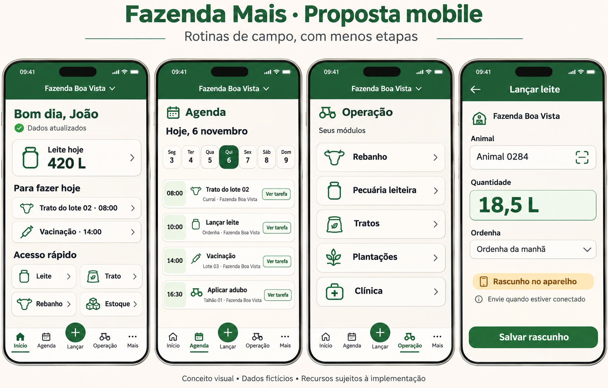

# Experiência mobile — dados e operações

A Agenda atualizada do app é a referência conceitual para a experiência das telas operacionais: contexto visível, controles compactos, informações legíveis e caminhos claros para agir. O objetivo é um aplicativo **simples, intuitivo e funcional**.

O [guia de design mobile](../DESIGN.md) é a referência das decisões visuais e de interação. Ele substitui prescrições antigas de layout, navegação e componentes. A composição da [Agenda atual](../src/features/agenda/AgendaScreen.tsx) orienta a hierarquia, sem exigir calendário em todos os módulos nem transformar detalhes ainda incompletos em padrão.

## Percurso principal

**Contexto → dados → detalhe ou ação → revisão → confirmação → retorno ao contexto.**

1. A tela informa módulo, fazenda e a seleção relevante: período, animal, lote ou produto.
2. A lista mostra os dados necessários para reconhecer o registro, sua situação e eventuais pendências.
3. O usuário abre a ficha ou inicia a operação permitida, recebendo o contexto já selecionado.
4. O formulário pede os campos exigidos pelo contrato, mostra erros junto das entradas e oferece revisão quando houver efeitos.
5. A confirmação remota informa o resultado. Erro ou resposta incerta preserva os dados e orienta a conferência.
6. O retorno permite continuar o trabalho sem refazer busca, filtros e seleção, conforme o fluxo suportado.

## Navegação e conteúdo

Reutilizar o `WorkspaceShell` atual: Início, Agenda, criação contextual, Financeiro e Módulos conforme o acesso. A proposta antiga de destinos fixos “Operação” e “Mais” não prescreve a navegação atual. Fichas e formulários mantêm retorno apropriado e espaço para teclado e ações.

| Área | O que deve ficar claro | Próximo passo |
| --- | --- | --- |
| Início | Prioridades e resumos úteis ao perfil | Abrir a atividade ou o lançamento relevante |
| Agenda | Período, atividades, situação e origem | Ver detalhe e seguir para a operação vinculada |
| Rebanho | Identificação, lote, situação e histórico | Abrir ficha e escolher manejo autorizado |
| Leite | Data, produção, descarte e pendências | Lançar/corrigir animal ou total, conforme contrato |
| Trato | Destino, produto, quantidade e fornecimento | Revisar impacto em estoque e confirmar |
| Estoque | Produto, saldo/unidade, validade e alertas | Consultar ficha/histórico ou registrar movimento permitido |
| Clínica | Animal/lote, ocorrência, data e acompanhamento | Consultar detalhe e realizar a ação disponível |

A tabela define a intenção da experiência, não a cobertura funcional de cada módulo. Verificar os destinos implementados antes de criar atalhos. Quando a operação ainda for web, identificar a abertura do navegador. O feeder mantém sua rotina e seus acessos próprios; ocultar um botão não substitui autorização do servidor.

## O que aproveitar da Agenda

- Fazenda e ação principal próximas do contexto de trabalho.
- Período e modos Mês/Semana/Lista agrupados quando a data for relevante; controles próprios do domínio nos demais módulos.
- Filtros frequentes com rótulos curtos e seleção evidente, sem deslocar os dados desnecessariamente.
- Resumo que explica a lista, cartões de leitura rápida e detalhe progressivo.
- Situação textual e destino compreensível para a próxima operação.

A hierarquia deve funcionar em telas pequenas e com fonte ampliada. Permitir rolagem em vez de apertar controles para caber uma quantidade fixa de conteúdo na primeira dobra. Preservar alvos de toque de 44 unidades lógicas, fonte de campo de 16 e áreas seguras. Medidas e acabamento estão no guia de design.

## Contexto de fazenda

O seletor global de fazendas foi retirado das telas principais. Quando houver contexto definido, o nome aparece apenas como informação. Cadastros e consultas cujo contrato exige uma fazenda continuam permitindo informá-la ao iniciar a operação; ações de total de leite, tanque, manejo, protocolo, pasto e ocorrência não ficam bloqueadas pela ausência do antigo seletor. A seleção operacional e os parâmetros de registros existentes preservam os contratos de acesso e isolamento. Validação: 51 testes direcionados, TypeScript e ESLint aprovados. Conferência visual em larguras pequena/maior e aparelhos Android/iOS permanece pendente.

## Menu de módulos

O painel de Módulos agrupa os destinos em Atividades, Dia a dia, Gestão e Conta/ferramentas. A busca permanece no cabeçalho enquanto os grupos rolam e aceita nomes sem acentos, descrições e nomes das categorias. Cada linha reúne ícone, título, descrição e acesso; a área atual é destacada, e os destinos que dependem do navegador recebem indicação Web. Fechar pelo cabeçalho, pelo fundo ou pelo botão voltar mantém a navegação existente; ao escolher um destino, o teclado é dispensado.

A lista usa as capacidades já autorizadas da sessão: filtrar não revela módulos indisponíveis nem altera as permissões do destino. As quatro traduções cobrem títulos, descrições e grupos. Validação de lógica de busca/permissões e compilação concluída; conferência visual em larguras pequena/maior e validação Android/iOS permanecem pendentes nesta alteração.

## Entrada da pecuária leiteira

`/cattle/dairy` abre um painel com três abas, sem seletor global de fazenda:

- **Visão geral:** alinhada à home web leiteira: data de referência, oito cartões de indicadores (lactação, produção/média/descarte mensais, vacas totais/secas, bezerras/novilhas e touros), seguidos dos acessos às operações nativas. Uma coluna no celular e duas em largura maior, voltando a uma com fonte ampliada. Não há seletor global de fazenda.
- **Rebanho:** painel com contagem do filtro devolvida pelo servidor, abas Animais/Lotes, cadastro contextual e busca/filtros sob demanda. Cartões com identificação, ícone de bovino/lote, situação/lactação, categoria, sexo ou quantidade e peso quando informado. A linha abre a ficha. Não se calculam totais do rebanho a partir de uma página parcial.
- **Rotinas:** cartões de acesso agrupados em produção/armazenamento, rebanho/cuidados e manejos/operações, com ícones próprios de leite, tanque, evolução, reprodução, trato, pasto e manejo. Uma coluna em celular e duas em largura maior; descrições curtas e permissões de cada perfil preservadas.

A Visão geral consome `livestock/cattle/dairy-overview/`, a mesma API da home web, pelo cliente de serviços e com as permissões existentes de bovinos. Confere a data devolvida, mantém médias desconhecidas como ausência e distingue os acumulados até a referência do rebanho ativo atual (`herd_as_of`). Erros oferecem nova consulta e não viram zeros. Produção, trato, tanques e reprodução abrem destinos nativos existentes; rebanho e rotinas abrem suas abas. Validação: 64 testes direcionados (7 novos), TypeScript/ESLint e bundles Android/iOS/web aprovados. Prévia web sintética em 320/768 px sem overflow horizontal ou exceções, com data inválida preservada e mudança de referência conferida. Homologação nativa Android/iOS, teclado e leitor de tela permanecem pendentes.

**Refinamento das três abas (13/11/2026):** ícones SVG nativos do domínio substituem símbolos genéricos, sem nova dependência. Rebanho e Rotinas seguem os cartões, círculos coloridos e hierarquia da Visão geral; grades voltam a uma coluna com fonte ampliada. Validação: 20 testes direcionados, TypeScript/ESLint e exportação Android/iOS/web aprovados. Prévia com dados sintéticos em 320/768 px conferiu animais, lotes, rotinas, ícones e busca, sem overflow horizontal ou exceções. Testes em aparelhos, teclado e leitor de tela permanecem pendentes.

## Consulta e histórico do trato diário

P04.13/P09 organiza a consulta em dia do servidor → segmento → lotes → ficha/fornecimentos → lançamento autorizado. A lista prioriza contagem do filtro, animais no lote e kg já fornecidos, sem somar páginas para criar um total. Busca abre sob demanda; o cartão leva à ficha, que concentra o lançamento e mostra histórico com responsável/horário. Notas e identificador ficam nos detalhes. O filtro global de fazenda não é oferecido.

A ficha impede iniciar um lançamento enquanto atualiza ou apresenta erro. Histórico de outro dia operacional não é mostrado como sendo do lote selecionado: oferece atualização e mantém o lançamento bloqueado até recuperar um conjunto coerente. Os contratos de revisão, confirmação, efeito em estoque e reconciliação do formulário existente foram preservados. Sem envio offline ou novas operações financeiras.

Validação: 10 testes direcionados, TypeScript/ESLint e bundles Android/iOS/web aprovados. Prévia com API sintética em 320/768 px conferiu lista/ficha sem overflow horizontal, detalhes, busca vazia, divergência de dia com lançamento bloqueado e recuperação, sem exceções de execução. Nenhum fornecimento real foi registrado. Homologação em Android/iOS, teclado, fonte ampliada e piloto permanecem pendentes.

## Exemplo de rotina de leite

1. Abrir Leite por um destino autorizado e manter a fazenda selecionada.
2. Localizar o animal ou selecionar o lançamento total, conforme as opções realmente disponíveis.
3. Informar data, turno, quantidade, descarte e demais campos exigidos pelo contrato; manter unidades e parsing de decimal nos quatro idiomas.
4. Revisar e enviar online; mostrar confirmação apenas depois da resposta do servidor. Se houver resultado incerto, orientar a conferência sem criar outra intenção de envio.
5. Continuar no mesmo contexto após a confirmação, oferecendo próximo animal apenas quando esse comportamento estiver implementado.

Rascunho offline, scanner, câmera e sincronização exigem implementação e contratos próprios. Um desenho com esses recursos não os torna disponíveis nem comprova segurança de reenvio.

## Referência visual anterior

Essa imagem foi gerada em 6 de novembro de 2026, antes da atualização usada como referência. Contém dados fictícios, outra proposta de navegação e um formulário de rascunho ilustrativo. Não é captura do app atual nem critério de aceite. O [arquivo de prompt](mockups/PROMPT.md) preserva a origem e registra a orientação para próximas peças; a imagem não foi regenerada nesta revisão.

## Validação da experiência

Avaliar no aparelho tarefas reais: consultar uma atividade e encontrar sua operação, localizar um animal e registrar uma rotina autorizada. Observar tempo, toques, erros, recuperação e compreensão dos rótulos. Testar Android/iOS, larguras pequena e maior, rede ruim, teclado aberto e fonte ampliada.

Um fluxo está bem resolvido quando o usuário reconhece os dados, entende sua situação, encontra a ação e sabe se ela foi confirmada. Mockup ou prévia web isolados não comprovam essa experiência nativa.
