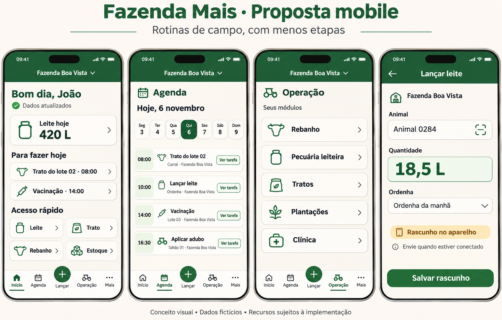

# Experiência mobile proposta

Conceito para avaliação, não aplicativo funcional. Dados, nomes e números da imagem são fictícios. As telas mostram possibilidades de um perfil com acesso aos módulos; cada usuário verá apenas suas ações autorizadas.

Imagem criada com a ferramenta integrada imagegen. O [prompt completo](mockups/PROMPT.md) registra a intenção visual. A especificação abaixo prevalece sobre detalhes ilustrativos: o calendário do desenho não é uma referência de datas, e textos ou campos omitidos devem seguir os contratos reais.

## Navegação

Quatro destinos fixos e uma ação central: **Início · Agenda · + Lançar · Operação · Mais**. Lançar abre uma folha de ações permitidas, não uma quinta seção; cancelar retorna à tela atual. Para perfis restritos, remover destinos não autorizados e manter a tarefa principal facilmente acessível. Não exibir a Agenda ao feeder sem um contrato que autorize esse acesso.

| Destino | Conteúdo | Benefício esperado |
| --- | --- | --- |
| Início | Prioridades do dia, poucos indicadores e atalhos por perfil | Começar pela próxima ação, sem procurar no menu lateral |
| Agenda | Lista diária/semanal, filtros simples e detalhe com ação contextual | Consultar o trabalho previsto sem calendário mensal apertado |
| Lançar | Leite, trato ou outra operação permitida no contexto selecionado | Evitar percorrer módulos para registrar uma rotina |
| Operação | Módulos autorizados, busca e acesso às entidades | Acomodar pecuária e plantações sem impor uma aba exclusiva de rebanho |
| Mais | Estoque, financeiro, relatórios, estrutura, suporte e configurações, conforme acesso | Manter tarefas ocasionais acessíveis sem ocupar a navegação principal |

A fazenda permanece visível e selecionada durante o fluxo. Trocar fazenda com formulário aberto exige tratar os dados já preenchidos. Se houver apenas uma fazenda autorizada, não mostrar um seletor sem utilidade. Ausência de autorização resulta em estado explicativo, nunca fallback para outra organização.

## Fluxo de leite

1. Selecionar Lançar → Leite, preservando a fazenda atual.
2. Localizar animal por busca ou código, quando a busca por código estiver implementada e autorizada. Entrada manual permanece disponível.
3. Informar data, sessão e quantidade; descarte e observações conforme as regras vigentes. Usar teclado numérico e validar separador decimal nos quatro idiomas.
4. Online: revisar e enviar; mostrar confirmação só após resposta do servidor. Offline: salvar rascunho com indicação de que ainda não foi enviado.
5. Oferecer “próximo animal” após confirmação, preservando somente o contexto apropriado. Evitar envio duplicado por toque repetido.

O mockup mostra apenas uma seleção resumida de campos para comunicar a experiência. Não define o formulário final nem garante que envio offline de leite já seja seguro.

## Fluxos complementares

- Agenda → tarefa → detalhe → operação relacionada, quando houver vínculo válido. Converter links web para rotas nativas; testar também links recebidos com o app fechado.
- Operação → rebanho → animal → histórico e ações permitidas. Busca persistente e filtros úteis substituem tabelas largas.
- Feeder → trato autorizado → confirmação online, com indicação clara do impacto em estoque. Não liberar finanças ou módulos extras por causa de um atalho.
- Mais → estoque → consulta paginada. A consulta local mostra a última atualização; movimentação exige o contrato online apropriado.

## Layout e acessibilidade

Derivar o tema do verde e dos fundos claros do frontend atual, especialmente `frontend/src/app/globals.css`; reutilizar os logos existentes após validar legibilidade no ícone. Os elementos desenhados na imagem não substituem os arquivos oficiais de marca.

Manter densidade compacta, mas preservar texto e toque: corpo e campos em torno de 16 unidades lógicas, alvos de pelo menos 44, espaçamento consistente, contraste verificável e suporte a fontes ampliadas. Não transportar CSS desktop, zoom ou escala global para o app. Respeitar safe areas, teclado, botão voltar Android e gesto de retorno iOS.

Usar listas de cartões ou linhas curtas, detalhes progressivos e formulários em tela inteira. Evitar gráficos grandes no início e excesso de indicadores. Ações destrutivas precisam identificar o registro e o efeito; operações com impacto financeiro ou de estoque devem deixar esse impacto visível.

## Estados obrigatórios

Cada fluxo precisa contemplar carregamento, vazio, erro com nova tentativa, sem permissão, somente leitura, sessão expirada e rede indisponível. Diferenciar dados atualizados, cache antigo, rascunho local, aguardando envio, enviando, confirmado e conflito.

Não depender apenas de cor, vibração ou ícone. Textos acessíveis e mensagens claras devem funcionar sem permissão para câmera, notificações ou localização. Evitar bloquear a navegação por falha de um indicador secundário.

## Como validar a proposta

Testar no aparelho as mesmas três tarefas do PWA: consultar agenda, localizar animal e lançar leite. Medir tempo, toques, erros e conclusão; observar uso com uma mão, rede ruim, teclado aberto e fonte ampliada. Ajustar atalhos com base no papel e na frequência real, antes de construir todos os módulos.

A imagem foi inspecionada visualmente como conceito. A implementação ainda exigirá validação em aparelhos e revisão de acessibilidade; um mockup não comprova usabilidade, desempenho ou funcionamento offline.
